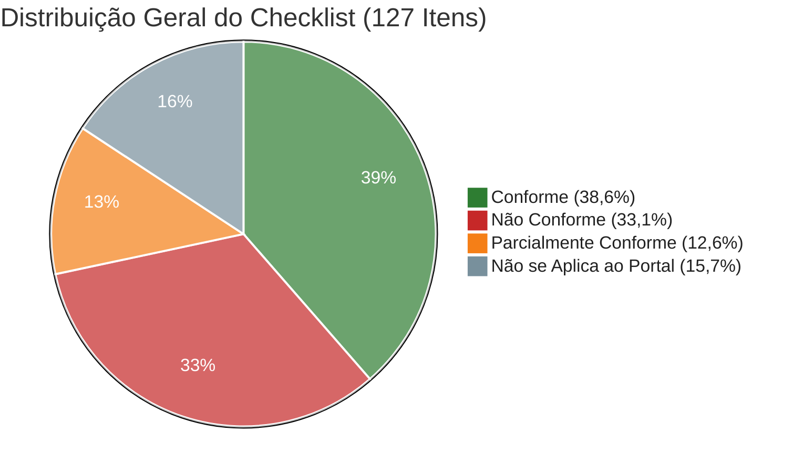
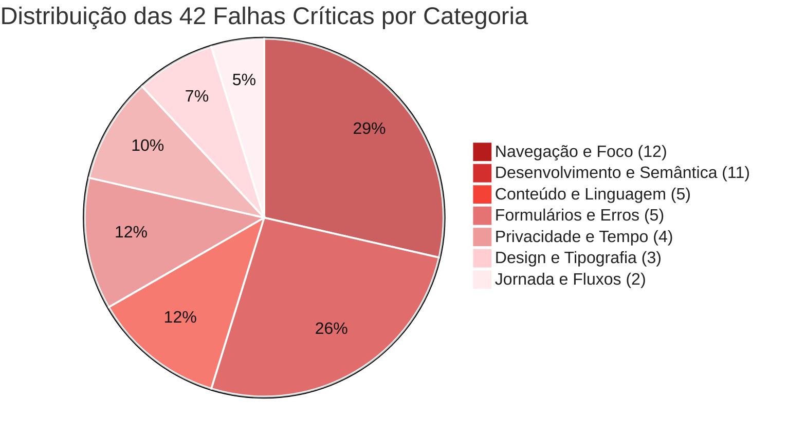
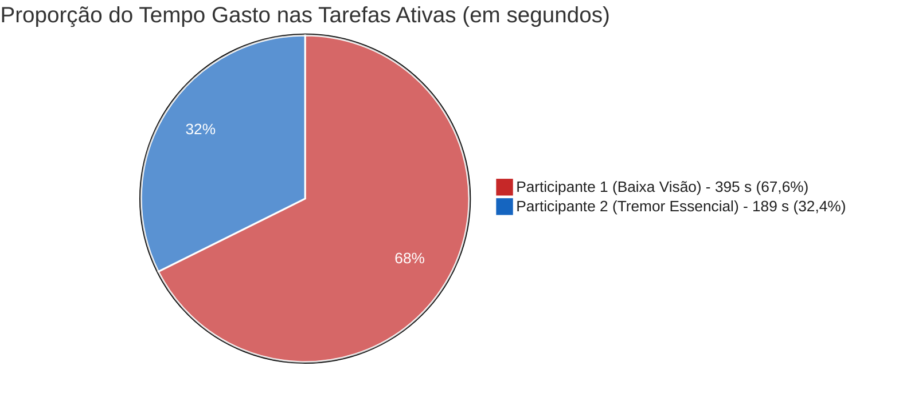
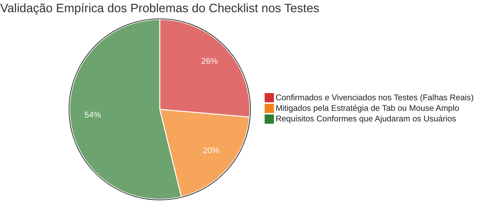
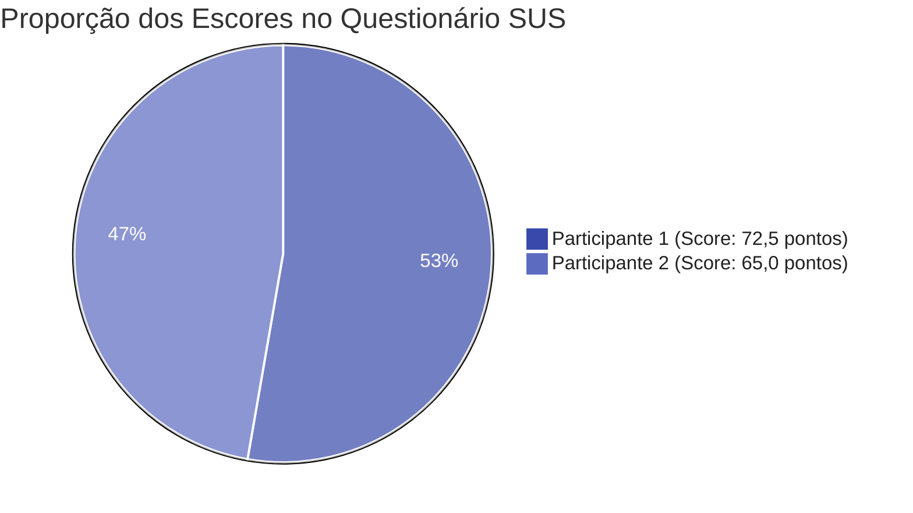

# 📊 Análise de Dados de Acessibilidade e Usabilidade — Portal Fala.BR

**Projeto:** Avaliação de Acessibilidade Digital e Usabilidade — Portal Fala.BR (CGU)  
**Disciplina:** Interação Humano-Computador (IHC) — Universidade de Brasília (UnB)  

Esta análise consolida os dados obtidos na avaliação técnica do portal Fala.BR (baseada nas normas ABNT NBR 17225:2025, W3C WCAG 2.2 e Guia de Boas Práticas Reino Unido–Brasil) em conjunto com as evidências empíricas coletadas nas sessões de testes com usuários reais e aplicação da escala SUS (*System Usability Scale*).

---

## 📌 1. Visão Geral e Indicadores Principais

A combinação entre a inspeção técnica de código, a árvore de acessibilidade (simulação de leitores de tela) e os testes práticos com usuários revelou que o Fala.BR possui um comportamento assimétrico: visualmente é padronizado e espaçoso, mas esconde dificuldades severas na camada de teclado, na semântica do código, no tamanho de fonte para baixa visão e na ausência de informações essenciais na tela inicial.

### Distribuição Geral do Checklist (Total: 127 Itens)

| Status da Diretriz | Quantidade | Proporção sobre o Total (127 Itens) | Proporção sobre Itens Aplicáveis (107 Itens) |
| :--- | :---: | :---: | :---: |
| 🟢 **Conforme** | **49** | `38,6%` | `45,8%` |
| 🔴 **Não Conforme** | **42** | `33,1%` | `39,3%` |
| 🟡 **Parcialmente Conforme** | **16** | `12,6%` | `15,0%` |
| ⚪ **Não se Aplica ao Portal** | **20** | `15,7%` | *Desconsiderado* |

> **Nota:** Desconsiderando os 20 itens que tratam de recursos ausentes no escopo (como áudios nativos, vídeos, biometria e tabelas complexas), **54,2% das diretrizes aplicáveis (58 de 107 itens)** apresentam falhas totais ou parciais de acessibilidade.

---

## 🧩 2. Distribuição das Falhas Críticas por Categoria

Nem todas as áreas do site apresentam os mesmos desafios. Abaixo, vemos como as **42 reprovações diretas (Não Conforme)** estão distribuídas entre as grandes classes avaliadas:

---

## 👥 3. Métricas e Resultados Consolidados por Tarefa (Seção 3 e 4)

Com base na minutagem cronometrada a partir dos vídeos gravados e no protocolo metodológico oficial de IHC (Rubin & Chisnell, 2008; Tullis & Albert, 2013):

* **Participante 1 (P1):** Mulher, 48 anos, baixa visão / presbiopia severa (depende de aumento de letra e zoom).
* **Participante 2 (P2):** Homem, 21 anos, limitação motora (Tremor Essencial). **Estratégia assistiva observada no vídeo: uso intensivo da tecla TAB no teclado para alternar campos e evitar cliques trêmulos com o mouse.**

### 3.1 Tabela Geral de Resultados por Tarefa

| Participante | Tarefa | Início | Fim | Tempo na Tarefa (s) | Desfecho Oficial | Nº de Erros | Hesitações e Ocorrências Relevantes |
| :--- | :---: | :---: | :---: | :---: | :---: | :---: | :--- |
| **P1 (Baixa Visão)** | **Tarefa 1** | 02:24 | 05:15 | **171 s** (2m51s) | **Sucesso com ajuda** | **1 erro** | Acessou menu errado; orientador pediu para voltar; retornou à Home em 03:30; página travou e exigiu F5. |
| **P1 (Baixa Visão)** | **Tarefa 2** | 06:40 | 08:20 | **100 s** (1m40s) | **Sucesso sem ajuda** | **1 erro** | Clicou repetidas vezes no dropdown sem digitar; demorou a entender que exigia busca textual. |
| **P1 (Baixa Visão)** | **Tarefa 3** | 09:26 | 11:30 | **124 s** (2m04s) | **Sucesso sem ajuda** | **0 erros** | Preenchimento e revisão fluida até a tela do Passo 5. |
| **P2 (Tremor Essencial)** | **Tarefa 1** | 02:58 | 04:15 | **77 s** (1m17s) | **Sucesso sem ajuda** | **1 erro** | Não viu menção a anonimato; navegou com Tab; clicou em rota incorreta, mas retornou sozinho. |
| **P2 (Tremor Essencial)** | **Tarefa 2** | 04:58 | 05:45 | **47 s** (0m47s) | **Sucesso sem ajuda** | **0 erros** | Uso ágil do Tab para saltar entre campos e digitar Universidade de Brasília. |
| **P2 (Tremor Essencial)** | **Tarefa 3** | 07:05 | 08:10 | **65 s** (1m05s) | **Sucesso sem ajuda** | **0 erros** | Alternou entre Tab e cliques largos de botões até a tela de revisão final. |

### 3.2 Taxa de Sucesso Oficial (Nielsen & Budiu, 2001)

* **Tarefas com Sucesso sem Ajuda:** $5 / 6 = \mathbf{83,3\%}$
* **Tarefas com Sucesso com Ajuda:** $1 / 6 = \mathbf{16,7\%}$ (Tarefa 1 de P1)
* **Falhas / Desistências:** $0 / 6 = \mathbf{0,0\%}$

---

## ⏱️ 4. Comparativo de Tempo por Tarefa (P1 vs. P2 vs. Ensaio de Referência)

O tempo total nas tarefas ativas foi de **395 segundos (6m35s)** para P1 e **189 segundos (3m09s)** para P2. A participante com baixa visão levou mais que o dobro do tempo (+109,0%).

| Tarefa | Tempo de Referência (Ensaio) | Tempo P2 (Tremor Essencial) | Tempo P1 (Baixa Visão) | Diferença P1 vs. P2 | Fatores que Explicam a Diferença |
| :--- | :---: | :---: | :---: | :---: | :--- |
| **Tarefa 1: Anonimato** | 40 s | **77 s** | **171 s** | **+122,1%** | P1 teve desvio de menu + intervenção do mediador + travamento da página aos 03:30. |
| **Tarefa 2: Assunto e Órgão** | 55 s | **47 s** | **100 s** | **+112,8%** | P2 usou Tab e digitou direto; P1 clicou seguidas vezes achando que era dropdown comum. |
| **Tarefa 3: Até Revisão** | 70 s | **65 s** | **124 s** | **+90,8%** | P2 avançou rápido com Tab e Enter; P1 demandou maior tempo para ler cada campo com fonte pequena. |
| **SOMA TOTAL** | **165 s** | **189 s** | **395 s** | **+109,0%** | **O uso do Tab acelerou P2, enquanto a fonte pequena e o dropdown atrasaram P1.** |

---

## 🔗 5. Cruzamento: Resultados do Checklist vs. Comportamento Real dos Usuários

Este cruzamento conecta diretamente **o que a inspeção técnica do checklist detectou** com **o que aconteceu de verdade durante a participação dos usuários nos vídeos**:

### Tabela de Cruzamento Direto: Diretriz do Checklist × Evidência Empírica nos Testes

| Item do Checklist de Acessibilidade | Status Técnico | O que o Checklist Apontou | Comportamento Real Observado nos Vídeos (P1 e P2) |
| :--- | :---: | :--- | :--- |
| **Item 44 e 45: Indicador de Foco Visível (`:focus-visible`) e Contraste $\ge 3:1$** | 🟢 **Conforme** | Borda pontilhada âmbar de 4px bem destacada em elementos focados. | **Crucial para o P2 (Tremor Essencial):** Como usou intensamente o `Tab`, o contorno âmbar de 4px permitiu que P2 soubesse exatamente onde estava sem perder o foco na tela. |
| **Item 46: Foco nunca encoberto por cabeçalhos fixos** | 🔴 **Não Conforme** | A barra superior fixa do governo sobrepõe os primeiros campos focados via `Tab`. | **Atrito para o P2:** Ao navegar com `Tab`, o foco entrou sob a barra fixa superior no início do formulário, exigindo rolagem manual para desobstruir a visão. |
| **Item 49: Link invisível de salto ("Pular para o conteúdo principal")** | 🔴 **Não Conforme** | Ausência de link de salto no início do DOM; primeiro elemento é menu de dados abertos. | **Sobrecarga motora para P2:** P2 precisou pressionar a tecla `Tab` repetidas vezes por todo o cabeçalho antes de alcançar o conteúdo do formulário. |
| **Item 42: Ordem lógica de foco (`tabindex`) passando só por interativos** | 🔴 **Não Conforme** | Textos e áreas não interativas interceptam a tabulação indevidamente. | **Hesitação do P2:** P2 teve que dar toques extras de `Tab` para vencer nós decorativos que capturavam o foco antes dos campos de entrada. |
| **Item 100 e 101: Área de clique mínima $\ge 44\text{px}$ e respiros visuais** | 🟢 **Conforme** | Botões principais amplos ($>44\text{px}$) e bom distanciamento visual. | **Proteção para P2:** Mesmo alternando entre teclado e mouse, quando usou o cursor não cometeu cliques falsos em botões adjacentes ("Voltar" vs. "Avançar"). |
| **Item 104: Fontes legíveis com bom tamanho (reprovado em tamanho)** | 🔴 **Não Conforme** | Tipografia padrão pequena para baixa visão; sem atalho de ampliação no topo. | **Barreira severa para P1 (Baixa Visão):** P1 queixou-se 4 vezes na entrevista final (*"as letras precisavam ser maiores"*), gerando fadiga de leitura e lentidão (395s). |
| **Item 110: Rótulo externo no relato (nunca depender só de placeholder)** | 🔴 **Não Conforme** | O campo do relato usa apenas placeholder cinza que desaparece ao digitar. | **Fricção cognitiva para P1:** P1 precisou reler pausadamente a caixa de texto antes de começar a escrever o relato de teste. |
| **Item 111: Dicas permanentes em componentes complexos** | 🟡 **Parcial** | O seletor de órgãos não informa que depende de digitação para abrir a listagem. | **Erro direto de P1 (Tarefa 2):** P1 tentou clicar repetidamente no seletor achando que era dropdown comum, levando 100s para concluir. |
| **Item 121: Orientações prévias na tela inicial** | 🔴 **Não Conforme** | A página inicial omite instruções claras sobre onde e como fazer denúncia anônima. | **Erro de rota em 100% dos usuários:** Tanto P1 quanto P2 clicaram em menus errados na Tarefa 1 por falta de um card de denúncia anônima na Home. |
| **Item 28, 29 e 123: Prevenção de perda de dados e salvar rascunho** | 🔴 **Não Conforme** | Ausência de retenção automática em caso de queda ou recarregamento. | **Vivenciado na prática por P1:** O site travou no minuto 03:30; se o erro ocorresse no Passo 4, P1 teria perdido todos os dados já digitados. |
| **Item 116 e 125: Tela de revisão e consistência de navegação** | 🟢 **Conforme** | Passo 5 consolidado para conferência com botões claros de navegação. | **Elogiado por P1 e P2:** Ambos navegaram com segurança na revisão final, validando seus dados sem qualquer dificuldade. |

---

## 📐 6. Avaliação de Usabilidade: Escala SUS

Ao término dos testes, ambos responderam ao questionário padronizado SUS (10 afirmações com notas de 1 a 5).

### Como cada participante pontuou cada aspecto do SUS?

| Afirmação do SUS (Escala de 1 a 5) | P1 (Baixa Visão) | P2 (Tremor) | O que isso reflete com base no uso do Tab e nas telas? |
| :--- | :---: | :---: | :--- |
| **1. Gostaria de usar frequentemente** | 2 | 2 | Sistema de ouvidoria de uso pontual. |
| **2. Achei desnecessariamente complexo** | 2 | 1 | O formulário em si tem passos lineares fáceis de entender. |
| **3. Achei fácil de usar** | 3 | 3 | **Neutro para ambos:** a navegação não é espontânea nem fluida. |
| **4. Precisaria de ajuda técnica para usar** | 2 / 3 | 1 | P1 sentiu dependência por causa da leitura e da intervenção que recebeu. |
| **5. Funções bem integradas** | 3 | 2 | P2 sentiu que a navegação por teclado da Home para dentro do formulário não é bem amarrada. |
| **6. Apresenta muita inconsistência** | 1 | 1 | **Ponto positivo:** padrão visual do Design System GOV.BR é consistente. |
| **7. A maioria das pessoas aprende rápido** | 5 | 2 | P1 achou fácil para videntes; P2 percebeu que o usuário comum se perde no fluxo. |
| **8. Achei pesado de usar** | 2 | 3 | P2 sentiu cansaço pela repetição excessiva de Tab no cabeçalho sem link de salto. |
| **9. Me senti seguro usando** | 4 | 4 | Boa credibilidade gerada pela tela de revisão e padrão institucional. |
| **10. Tive que aprender muitas coisas antes** | 1 | 1 | Não exige treinamento prévio. |
| **PONTUAÇÃO FINAL SUS** | **72,5 pts** | **65,0 pts** | **Média Geral: 68,75 pontos (Conceito C — Regular)** |

---

## 💡 7. Principais Insights Extraídos do Cruzamento dos Dados

### 1. O Tab como compensação motora: sucesso prático com custo de esforço
O participante com tremor essencial utilizou o teclado como tecnologia assistiva primária para evitar a instabilidade do mouse. Esse comportamento validou o acerto técnico do **foco visível âmbar de 4px (Item 44)**, permitindo tempos rápidos (47s na T2 e 65s na T3). Por outro lado, expôs brutalmente a falta do **Skip Link (Item 49)**: sem ele, P2 foi obrigado a teclar `Tab` repetidamente por dezenas de links do cabeçalho antes de começar a preencher o formulário.

### 2. A barreira da digitação obrigatória no seletor de órgãos
O cruzamento revela o motivo da discrepância temporal na Tarefa 2 (100s em P1 vs. 47s em P2): P2, já com as mãos posicionadas no teclado navegando por Tab, simplesmente digitou *"Universidade de Brasília"*. P1, utilizando o mouse e com visão ampliada, tentou clicar seguidas vezes na seta do dropdown esperando ver uma lista pronta, sendo barrada pela falta de um rótulo explicativo indicando que a busca exigia digitação prévia.

### 3. Dois caminhos errados idênticos na Tarefa 1 comprovam falha do sistema
O fato de P2 (navegando por teclado/mouse) e P1 (navegando por mouse/zoom) terem cometido exatamente o mesmo erro de rota inicial comprova empiricamente que a reprovação do **Item 121 (falta de orientação prévia de denúncia anônima)** não é teórica: ela induz 100% dos novos usuários a cliques desnecessários.

### 4. O paradoxo da auto-culpabilização no SUS
Mesmo demorando **o dobro do tempo (395s vs. 189s)** e necessitando de ajuda do facilitador, P1 deu nota SUS superior (72,5 vs. 65,0). O usuário com deficiência visual frequentemente assume para si a responsabilidade pela lentidão (*"eu que não enxergo direito"*), enquanto o usuário motor avaliou a interface sob a ótica da eficiência de navegação e esforço de busca.

### 5. Resiliência a falhas: a perda real de dados quase concretizada
A instabilidade enfrentada por P1 aos 03:30 (página travada que exigiu atualização F5) validou a gravidade das não conformidades dos **Itens 28, 29 e 123 (ausência de auto-save e salvamento de rascunho)**. Se o travamento ocorresse no Passo 4, após P1 vencer as dificuldades de leitura e digitação, todo o esforço teria sido perdido.
