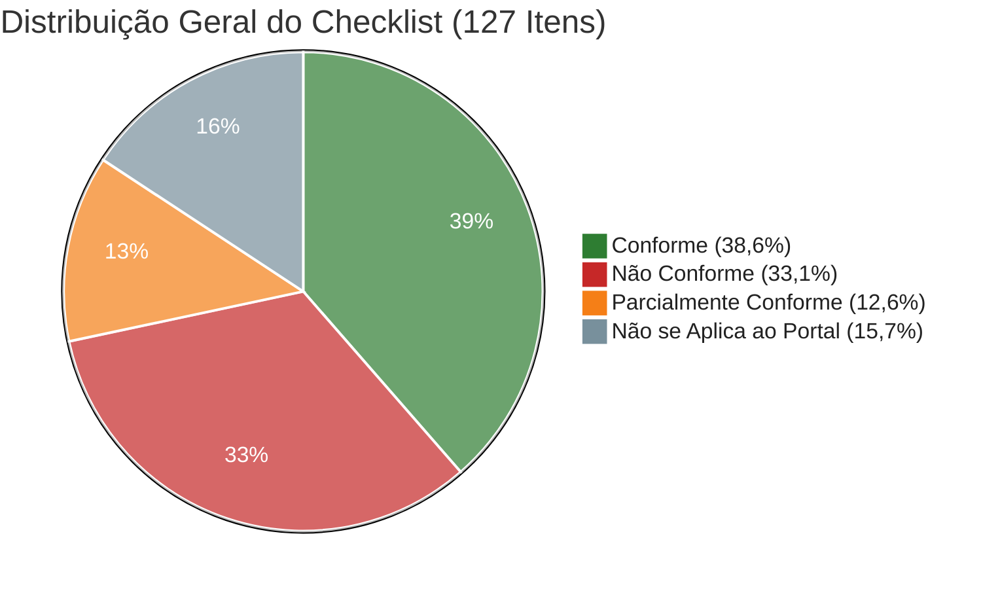
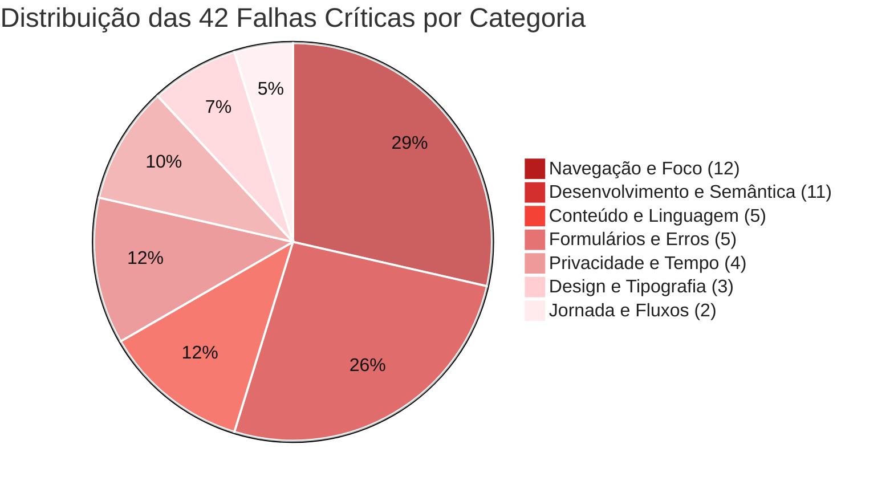
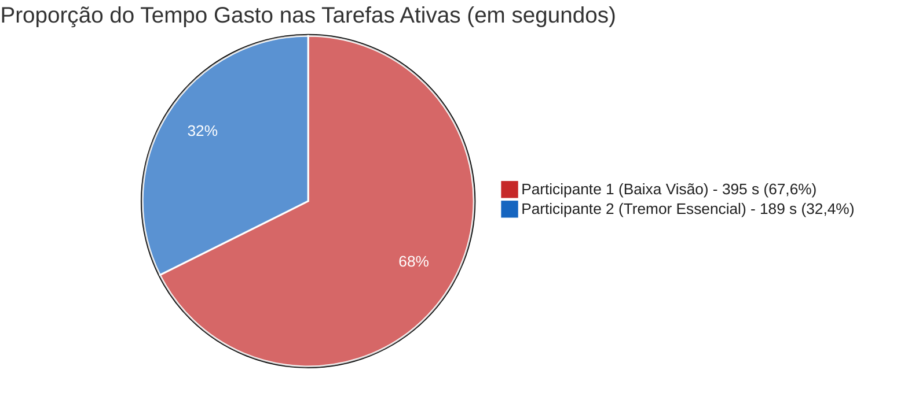
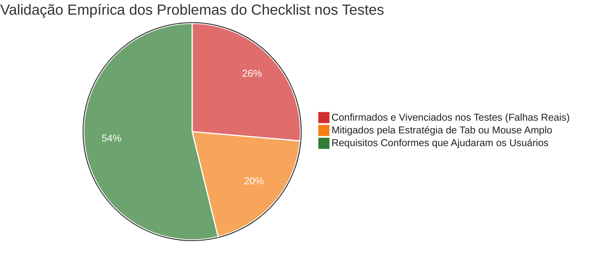
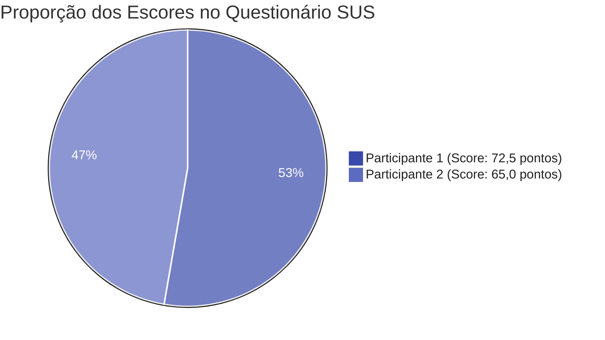
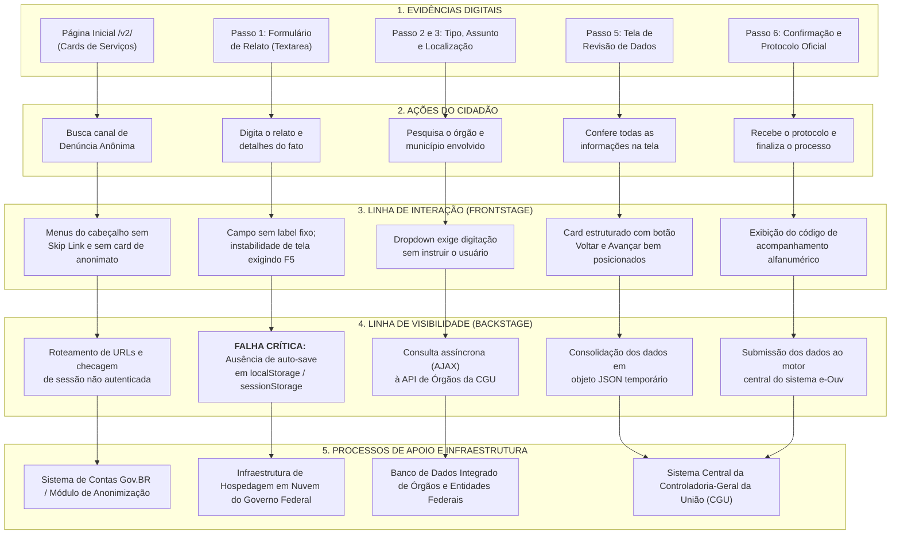

# Análise de Dados de Acessibilidade e Usabilidade — Portal Fala.BR

**Projeto:** Avaliação de Acessibilidade Digital e Usabilidade — Portal Fala.BR (CGU)  
**Disciplina:** Interação Humano-Computador (IHC) — Universidade de Brasília (UnB)  

Esta análise consolida os dados obtidos na avaliação técnica do portal Fala.BR (baseada nas normas ABNT NBR 17225:2025, W3C WCAG 2.2 e Guia de Boas Práticas Reino Unido–Brasil) em conjunto com as evidências empíricas coletadas nas sessões de testes com usuários reais e aplicação da escala SUS (*System Usability Scale*).

---

## 1. Visão Geral e Indicadores Principais

A combinação entre a inspeção técnica de código, a árvore de acessibilidade (simulação de leitores de tela) e os testes práticos com usuários revelou que o Fala.BR possui um comportamento assimétrico: visualmente é padronizado e espaçoso, mas esconde dificuldades severas na camada de teclado, na semântica do código, no tamanho de fonte para baixa visão e na ausência de informações essenciais na tela inicial.

### Distribuição Geral do Checklist (Total: 127 Itens)

| Status da Diretriz | Quantidade | Proporção sobre o Total (127 Itens) | Proporção sobre Itens Aplicáveis (107 Itens) |
| :--- | :---: | :---: | :---: |
| 🟢 **Conforme** | **49** | `38,6%` | `45,8%` |
| 🔴 **Não Conforme** | **42** | `33,1%` | `39,3%` |
| 🟡 **Parcialmente Conforme** | **16** | `12,6%` | `15,0%` |
| ⚪ **Não se Aplica ao Portal** | **20** | `15,7%` | *Desconsiderado* |

> **Nota:** Desconsiderando os 20 itens que tratam de recursos ausentes no escopo (como áudios nativos, vídeos, biometria e tabelas complexas), **54,2% das diretrizes aplicáveis (58 de 107 itens)** apresentam falhas totais ou parciais de acessibilidade.

---

## 2. Distribuição das Falhas Críticas por Categoria

Nem todas as áreas do site apresentam os mesmos desafios. Abaixo, vemos como as **42 reprovações diretas (Não Conforme)** estão distribuídas entre as grandes classes avaliadas:

---

## 3. Métricas e Resultados Consolidados por Tarefa (Seção 3 e 4)

Com base na minutagem cronometrada a partir dos vídeos gravados e no protocolo metodológico oficial de IHC (Rubin & Chisnell, 2008; Tullis & Albert, 2013):

* **Participante 1 (P1):** Mulher, 48 anos, baixa visão / presbiopia severa (depende de aumento de letra e zoom).
* **Participante 2 (P2):** Homem, 20 anos, limitação motora (Tremor Essencial). **Estratégia assistiva observada no vídeo: uso intensivo da tecla TAB no teclado para alternar campos e evitar cliques trêmulos com o mouse.**

### 3.1 Tabela Geral de Resultados por Tarefa

| Participante | Tarefa | Início | Fim | Tempo na Tarefa (s) | Desfecho Oficial | Nº de Erros | Hesitações e Ocorrências Relevantes |
| :--- | :---: | :---: | :---: | :---: | :---: | :---: | :--- |
| **P1 (Baixa Visão)** | **Tarefa 1** | 02:24 | 05:15 | **171 s** (2m51s) | **Sucesso com ajuda** | **1 erro** | Acessou menu errado; orientador pediu para voltar; retornou à Home em 03:30; página travou e exigiu F5. |
| **P1 (Baixa Visão)** | **Tarefa 2** | 06:40 | 08:20 | **100 s** (1m40s) | **Sucesso sem ajuda** | **1 erro** | Clicou repetidas vezes no dropdown sem digitar; demorou a entender que exigia busca textual. |
| **P1 (Baixa Visão)** | **Tarefa 3** | 09:26 | 11:30 | **124 s** (2m04s) | **Sucesso sem ajuda** | **0 erros** | Preenchimento e revisão fluida até a tela do Passo 5. |
| **P2 (Tremor Essencial)** | **Tarefa 1** | 02:58 | 04:15 | **77 s** (1m17s) | **Sucesso sem ajuda** | **1 erro** | Não viu menção a anonimato; navegou com Tab; clicou em rota incorreta, mas retornou sozinho. |
| **P2 (Tremor Essencial)** | **Tarefa 2** | 04:58 | 05:45 | **47 s** (0m47s) | **Sucesso sem ajuda** | **0 erros** | Uso ágil do Tab para saltar entre campos e digitar Universidade de Brasília. |
| **P2 (Tremor Essencial)** | **Tarefa 3** | 07:05 | 08:10 | **65 s** (1m05s) | **Sucesso sem ajuda** | **0 erros** | Alternou entre Tab e cliques largos de botões até a tela de revisão final. |

### 3.2 Taxa de Sucesso Oficial (Nielsen & Budiu, 2001)

* **Tarefas com Sucesso sem Ajuda:** $5 / 6 = \mathbf{83,3\%}$
* **Tarefas com Sucesso com Ajuda:** $1 / 6 = \mathbf{16,7\%}$ (Tarefa 1 de P1)
* **Falhas / Desistências:** $0 / 6 = \mathbf{0,0\%}$

---

## 4. Comparativo de Tempo por Tarefa (P1 vs. P2 vs. Ensaio de Referência)

O tempo total nas tarefas ativas foi de **395 segundos (6m35s)** para P1 e **189 segundos (3m09s)** para P2. A participante com baixa visão levou mais que o dobro do tempo (+109,0%).

| Tarefa | Tempo de Referência (Ensaio) | Tempo P2 (Tremor Essencial) | Tempo P1 (Baixa Visão) | Diferença P1 vs. P2 | Fatores que Explicam a Diferença |
| :--- | :---: | :---: | :---: | :---: | :--- |
| **Tarefa 1: Anonimato** | 40 s | **77 s** | **171 s** | **+122,1%** | P1 teve desvio de menu + intervenção do mediador + travamento da página aos 03:30. |
| **Tarefa 2: Assunto e Órgão** | 55 s | **47 s** | **100 s** | **+112,8%** | P2 usou Tab e digitou direto; P1 clicou seguidas vezes achando que era dropdown comum. |
| **Tarefa 3: Até Revisão** | 70 s | **65 s** | **124 s** | **+90,8%** | P2 avançou rápido com Tab e Enter; P1 demandou maior tempo para ler cada campo com fonte pequena. |
| **SOMA TOTAL** | **165 s** | **189 s** | **395 s** | **+109,0%** | **O uso do Tab acelerou P2, enquanto a fonte pequena e o dropdown atrasaram P1.** |

---

## 5. Cruzamento: Resultados do Checklist vs. Comportamento Real dos Usuários

Este cruzamento conecta diretamente **o que a inspeção técnica do checklist detectou** com **o que aconteceu de verdade durante a participação dos usuários nos vídeos**:

### Tabela de Cruzamento Direto: Diretriz do Checklist × Evidência Empírica nos Testes

| Item do Checklist de Acessibilidade | Status Técnico | O que o Checklist Apontou | Comportamento Real Observado nos Vídeos (P1 e P2) |
| :--- | :---: | :--- | :--- |
| **Item 44 e 45: Indicador de Foco Visível (`:focus-visible`) e Contraste $\ge 3:1$** | 🟢 **Conforme** | Borda pontilhada âmbar de 4px bem destacada em elementos focados. | **Crucial para o P2 (Tremor Essencial):** Como usou intensamente o `Tab`, o contorno âmbar de 4px permitiu que P2 soubesse exatamente onde estava sem perder o foco na tela. |
| **Item 46: Foco nunca encoberto por cabeçalhos fixos** | 🔴 **Não Conforme** | A barra superior fixa do governo sobrepõe os primeiros campos focados via `Tab`. | **Atrito para o P2:** Ao navegar com `Tab`, o foco entrou sob a barra fixa superior no início do formulário, exigindo rolagem manual para desobstruir a visão. |
| **Item 49: Link invisível de salto ("Pular para o conteúdo principal")** | 🔴 **Não Conforme** | Ausência de link de salto no início do DOM; primeiro elemento é menu de dados abertos. | **Sobrecarga motora para P2:** P2 precisou pressionar a tecla `Tab` repetidas vezes por todo o cabeçalho antes de alcançar o conteúdo do formulário. |
| **Item 42: Ordem lógica de foco (`tabindex`) passando só por interativos** | 🔴 **Não Conforme** | Textos e áreas não interativas interceptam a tabulação indevidamente. | **Hesitação do P2:** P2 teve que dar toques extras de `Tab` para vencer nós decorativos que capturavam o foco antes dos campos de entrada. |
| **Item 100 e 101: Área de clique mínima $\ge 44\text{px}$ e respiros visuais** | 🟢 **Conforme** | Botões principais amplos ($>44\text{px}$) e bom distanciamento visual. | **Proteção para P2:** Mesmo alternando entre teclado e mouse, quando usou o cursor não cometeu cliques falsos em botões adjacentes ("Voltar" vs. "Avançar"). |
| **Item 104: Fontes legíveis com bom tamanho (reprovado em tamanho)** | 🔴 **Não Conforme** | Tipografia padrão pequena para baixa visão; sem atalho de ampliação no topo. | **Barreira severa para P1 (Baixa Visão):** P1 queixou-se 4 vezes na entrevista final (*"as letras precisavam ser maiores"*), gerando fadiga de leitura e lentidão (395s). |
| **Item 110: Rótulo externo no relato (nunca depender só de placeholder)** | 🔴 **Não Conforme** | O campo do relato usa apenas placeholder cinza que desaparece ao digitar. | **Fricção cognitiva para P1:** P1 precisou reler pausadamente a caixa de texto antes de começar a escrever o relato de teste. |
| **Item 111: Dicas permanentes em componentes complexos** | 🟡 **Parcial** | O seletor de órgãos não informa que depende de digitação para abrir a listagem. | **Erro direto de P1 (Tarefa 2):** P1 tentou clicar repetidamente no seletor achando que era dropdown comum, levando 100s para concluir. |
| **Item 121: Orientações prévias na tela inicial** | 🔴 **Não Conforme** | A página inicial omite instruções claras sobre onde e como fazer denúncia anônima. | **Erro de rota em 100% dos usuários:** Tanto P1 quanto P2 clicaram em menus errados na Tarefa 1 por falta de um card de denúncia anônima na Home. |
| **Item 28, 29 e 123: Prevenção de perda de dados e salvar rascunho** | 🔴 **Não Conforme** | Ausência de retenção automática em caso de queda ou recarregamento. | **Vivenciado na prática por P1:** O site travou no minuto 03:30; se o erro ocorresse no Passo 4, P1 teria perdido todos os dados já digitados. |
| **Item 116 e 125: Tela de revisão e consistência de navegação** | 🟢 **Conforme** | Passo 5 consolidado para conferência com botões claros de navegação. | **Elogiado por P1 e P2:** Ambos navegaram com segurança na revisão final, validando seus dados sem qualquer dificuldade. |

---

## 6. Avaliação de Usabilidade: Escala SUS

Ao término dos testes, ambos responderam ao questionário padronizado SUS (10 afirmações com notas de 1 a 5).

### Como cada participante pontuou cada aspecto do SUS?

| Afirmação do SUS (Escala de 1 a 5) | P1 (Baixa Visão) | P2 (Tremor) | O que isso reflete com base no uso do Tab e nas telas? |
| :--- | :---: | :---: | :--- |
| **1. Gostaria de usar frequentemente** | 2 | 2 | Sistema de ouvidoria de uso pontual. |
| **2. Achei desnecessariamente complexo** | 2 | 1 | O formulário em si tem passos lineares fáceis de entender. |
| **3. Achei fácil de usar** | 3 | 3 | **Neutro para ambos:** a navegação não é espontânea nem fluida. |
| **4. Precisaria de ajuda técnica para usar** | 2 / 3 | 1 | P1 sentiu dependência por causa da leitura e da intervenção que recebeu. |
| **5. Funções bem integradas** | 3 | 2 | P2 sentiu que a navegação por teclado da Home para dentro do formulário não é bem amarrada. |
| **6. Apresenta muita inconsistência** | 1 | 1 | **Ponto positivo:** padrão visual do Design System GOV.BR é consistente. |
| **7. A maioria das pessoas aprende rápido** | 5 | 2 | P1 achou fácil para videntes; P2 percebeu que o usuário comum se perde no fluxo. |
| **8. Achei pesado de usar** | 2 | 3 | P2 sentiu cansaço pela repetição excessiva de Tab no cabeçalho sem link de salto. |
| **9. Me senti seguro usando** | 4 | 4 | Boa credibilidade gerada pela tela de revisão e padrão institucional. |
| **10. Tive que aprender muitas coisas antes** | 1 | 1 | Não exige treinamento prévio. |
| **PONTUAÇÃO FINAL SUS** | **72,5 pts** | **65,0 pts** | **Média Geral: 68,75 pontos (Conceito C — Regular)** |

---

## 7. Principais Insights Extraídos do Cruzamento dos Dados

### 1. O Tab como compensação motora: sucesso prático com custo de esforço
O participante com tremor essencial utilizou o teclado como tecnologia assistiva primária para evitar a instabilidade do mouse. Esse comportamento validou o acerto técnico do **foco visível âmbar de 4px (Item 44)**, permitindo tempos rápidos (47s na T2 e 65s na T3). Por outro lado, expôs brutalmente a falta do **Skip Link (Item 49)**: sem ele, P2 foi obrigado a teclar `Tab` repetidamente por dezenas de links do cabeçalho antes de começar a preencher o formulário.

### 2. A barreira da digitação obrigatória no seletor de órgãos
O cruzamento revela o motivo da discrepância temporal na Tarefa 2 (100s em P1 vs. 47s em P2): P2, já com as mãos posicionadas no teclado navegando por Tab, simplesmente digitou *"Universidade de Brasília"*. P1, utilizando o mouse e com visão ampliada, tentou clicar seguidas vezes na seta do dropdown esperando ver uma lista pronta, sendo barrada pela falta de um rótulo explicativo indicando que a busca exigia digitação prévia.

### 3. Dois caminhos errados idênticos na Tarefa 1 comprovam falha do sistema
O fato de P2 (navegando por teclado/mouse) e P1 (navegando por mouse/zoom) terem cometido exatamente o mesmo erro de rota inicial comprova empiricamente que a reprovação do **Item 121 (falta de orientação prévia de denúncia anônima)** não é teórica: ela induz 100% dos novos usuários a cliques desnecessários.

### 4. O paradoxo da auto-culpabilização no SUS
Mesmo demorando **o dobro do tempo (395s vs. 189s)** e necessitando de ajuda do facilitador, P1 deu nota SUS superior (72,5 vs. 65,0). O usuário com deficiência visual frequentemente assume para si a responsabilidade pela lentidão (*"eu que não enxergo direito"*), enquanto o usuário motor avaliou a interface sob a ótica da eficiência de navegação e esforço de busca.

### 5. Resiliência a falhas: a perda real de dados quase concretizada
A instabilidade enfrentada por P1 aos 03:30 (página travada que exigiu atualização F5) validou a gravidade das não conformidades dos **Itens 28, 29 e 123 (ausência de auto-save e salvamento de rascunho)**. Se o travamento ocorresse no Passo 4, após P1 vencer as dificuldades de leitura e digitação, todo o esforço teria sido perdido.

---

## 8. Personas Inclusivas Aplicadas ao Portal Fala.BR

Para fundamentar o diagnóstico empírico em modelos mentais reais, estruturamos duas personas fundamentadas nos dados dos testes e no Espectro de Habilidades:

### Persona 1: Maria Helena — Baixa Visão e Presbiopia Severa (Permanente / Sensorial)
* **Demografia:** 48 anos, servidora pública estadual, usuária assídua de computador e smartphone no trabalho.
* **Tecnologias Assistivas / Hábitos:** Utiliza óculos de alto grau, ativa rotineiramente o zoom do navegador (125% a 150%) e depende de fontes em bom tamanho e alto contraste. Não possui treinamento com leitores de tela narrativos.
* **Objetivo no Fala.BR:** Registrar uma manifestação pública de forma rápida, autônoma e sem necessidade de pedir ajuda a terceiros.
* **Barreiras Reais Enfrentadas no Portal:**
  * **Tipografia diminuta:** A escala tipográfica padrão do portal causou fadiga imediata de leitura (*"as letras precisavam ser maiores"* repetido 4 vezes).
  * **Placeholder frágil:** No Passo 1 (Relato), a ausência de um `<label>` fixo permanente gerou hesitação, pois a dica interna cinza desapareceu assim que o texto começou a ser inserido.
  * **Seletor de órgãos não intuitivo:** No Passo 2, clicou repetidas vezes na seta do dropdown esperando uma lista pronta, demorando 100 segundos para compreender que o componente exigia digitação prévia para autocompletar.
* **Tempo Total de Sessão:** **395 segundos (6m35s)** | **Escore SUS:** **72,5 pontos**.

---

### Persona 2: Lucas Ferreira — Tremor Essencial e Controle Motor Fino (Permanente / Motora)
* **Demografia:** 20 anos, estudante universitário, alto domínio de tecnologias digitais e navegação web.
* **Tecnologias Assistivas / Estratégia de Navegação:** Apresenta Tremor Essencial de grau moderado nas mãos, o que dificulta cliques estáveis em alvos pequenos com mouse ou trackpad. **Estratégia assistiva primária: navegação intensiva por teclado via tecla `Tab` e teclas direcionais.**
* **Objetivo no Fala.BR:** Denunciar uma irregularidade de forma 100% anônima e com a menor sobrecarga de cliques possível.
* **Barreiras Reais Enfrentadas no Portal:**
  * **Ausência de Skip Link:** Para chegar ao formulário, foi obrigado a pressionar `Tab` dezenas de vezes através dos menus repetitivos do cabeçalho da CGU.
  * **Arquitetura de informação falha na Home:** Não encontrou nenhuma menção explícita à denúncia anônima na tela inicial (`/v2/`), navegando inicialmente para rotas incorretas.
* **Pontos Positivos Identificados:** Aprovou o indicador de foco âmbar de 4px e a área generosa dos botões de ação ($>44\text{px}$).
* **Tempo Total de Sessão:** **189 segundos (3m09s)** | **Escore SUS:** **65,0 pontos**.

---

## 9. Mapa de Empatia do Cidadão no Portal Fala.BR

O Mapa de Empatia a seguir sintetiza a experiência dos usuários durante a interação com o Fala.BR:

| Quadrante | O que as evidências dos testes revelam |
| :--- | :--- |
| **O que VÊ?** | Uma interface com layout visual moderno e limpo à primeira vista, mas com textos de fontes pequenas, placeholders em cinza-claro de baixo contraste, seletores sem instruções visuais prévias e a ausência de um destaque frontal para "Denúncia Anônima". |
| **O que OUVE / LÊ?** | Leitores de tela anunciando nós decorativos desnecessários, botões rotulados genericamente como `aria-label="Botão"` (sem especificar a função) e textos com jargões burocráticos sobre termos de ouvidoria. |
| **O que DIZ e FAZ?** | Pressiona a tecla `Tab` dezenas de vezes para evitar o mouse; aproxima o rosto da tela para ler letras miúdas; clica seguidas vezes na seta de menus achando que são listas simples; relata verbalmente: *"as letras precisava ser maior"* e *"aqui eu não vejo nada de forma anônima"*. |
| **O que PENSA e SENTE?** | Sente hesitação e insegurança no início do fluxo; assume para si a culpa por não conseguir ler ("é porque eu não enxergo direito"); teme que o travamento da página apague todo o relato; sente alívio ao chegar na tela de revisão do Passo 5. |
| **DORES (*Pains*)** | • Travamento e instabilidade técnica sem rascunho salvo (PR-01). • Sobrecarga de foco no teclado por falta de Skip Link (PR-04). • Desorientação na página inicial sem atalho para denúncia anônima (PR-02). • Fadiga visual provocada por tipografia reduzida (PR-05). |
| **GANHOS (*Gains*)** | • Conclusão com sucesso da denúncia anônima. • Transparência e segurança garantidas na tela de revisão final (Passo 5). • Foco de alto contraste âmbar bem visível nos campos de texto. |

---

## 10. Service Blueprint do Fluxo de Denúncia Anônima

O Service Blueprint a seguir mapeia a jornada de registro de manifestações anônimas em suas cinco camadas, evidenciando as rupturas entre a interface e os serviços de retaguarda:

### Diagnóstico de Rupturas no Service Blueprint:
1. **Ponto de Ruptura 1 (Transição Home $\rightarrow$ Passo 1):** A falta de sincronização e a ausência de rascunho em *localStorage* transforma qualquer instabilidade de rede em um evento catastrófico (PR-01).
2. **Ponto de Ruptura 2 (Passo 2 — Chamada Assíncrona de Órgãos):** O componente visual não informa o status de consulta assíncrona (*loading*), fazendo com que usuários com lentidão cognitiva ou visual acreditem que o sistema parou de responder.

---

## 11. UX Canvas / Canvas de IHC do Projeto Fala.BR

| Bloco do Canvas | Definição Aplicada à Avaliação do Fala.BR |
| :--- | :--- |
| **1. Problema Central** | O portal Fala.BR possui barreiras de semântica, foco de teclado, tipografia reduzida e falta de persistência de dados que dificultam o exercício da cidadania por pessoas com deficiência. |
| **2. Usuários e Perfis Extremos** | Cidadãos com baixa visão/presbiopia severa (P1), pessoas com limitação motora/tremores (P2), idosos e denunciantes sob estresse emocional. |
| **3. Proposta de Valor** | Proporcionar um canal de ouvidoria federal plenamente inclusivo, autônomo, seguro e aderente às normas ABNT NBR 17225:2025 e WCAG 2.2 Nível AA. |
| **4. Soluções de Interface Propostas** | • Implementação de *Skip Link* no primeiro foco do cabeçalho. • Salvamento automático contínuo de rascunhos em cache local seguro. • Rótulos `<label>` fixos fora do campo e dicas visuais em dropdowns. • Controles nativos visíveis de ampliação de fonte (`A+` / `A-`). • Card direto de "Denúncia Anônima" na página inicial. |
| **5. Canais e Tecnologias** | Plataforma web responsiva em navegadores modernos, operável 100% via teclado e plenamente compatível com NVDA, TalkBack e ampliação de 200%. |
| **6. Restrições Técnicas e Normativas** | Conformidade obrigatória com a Lei Brasileira de Inclusão (Lei nº 13.146/2015), WCAG 2.2, LGPD (anonimização estrita) e Design System GOV.BR. |
| **7. Métricas de Sucesso (KPIs)** | • Escore SUS superior a **75 pontos** (Conceito B — Bom). • Taxa de conclusão de tarefas sem ajuda de **100%**. • Zero perda de dados em caso de instabilidade ou recarregamento acidental. |
| **8. Hipóteses de Melhoria** | Se adicionarmos o *Skip Link* e salvamento de rascunho, o tempo de navegação de usuários de teclado cairá pela metade e o abandono de manifestações será zerado. |
| **9. Impacto Social e Cidadão** | Democratização real do controle social e garantia de que nenhum brasileiro seja silenciado por barreiras digitais no canal oficial de ouvidoria da República. |

---

## 12. Avaliação Heurística de Nielsen do Portal Fala.BR (10 Heurísticas)

Realizamos a avaliação sistemática das **10 Heurísticas de Usabilidade de Jakob Nielsen (1994)** sobre o fluxo avaliado do Fala.BR:

| Heurística de Nielsen | Diagnóstico no Portal Fala.BR | Severidade (0 a 4) | Relação com Itens do Pocket |
| :--- | :--- | :---: | :---: |
| **H1. Visibilidade do status do sistema** | **Parcialmente Cumprida:** O formulário possui indicador visual de etapas ("Passo 2 de 5"), mas falha em anunciar estados dinâmicos para leitores de tela (falta de `aria-live`) e não indica quando a página está travada. | **2 (Menor)** | Itens 39 e 120 |
| **H2. Correspondência entre o sistema e o mundo real** | **Cumprida:** A sequência de perguntas (Relato $\rightarrow$ Órgão $\rightarrow$ Local $\rightarrow$ Revisão) reflete com precisão o modelo mental do registro de uma ocorrência cidadã. | **0 (Sem problema)** | Itens 119 e 125 |
| **H3. Controle e liberdade do usuário** | **Violada Gravemente:** Ausência de salvamento de rascunho (*auto-save*). O travamento da página sofrido por P1 exigiu F5 e colocou todos os dados em risco de perda total. | **4 (Catastrófico)** | Itens 28, 29 e 123 (PR-01) |
| **H4. Consistência e padrões** | **Cumprida:** O portal segue rigidamente a paleta e os componentes visuais padronizados do Design System GOV.BR, transmitindo credibilidade. | **0 (Sem problema)** | Itens 47, 48 e 125 |
| **H5. Prevenção de erros** | **Violada:** O seletor de órgãos não instrui que exige digitação prévia, induzindo o usuário a cliques repetidos frustrantes. | **3 (Grave)** | Itens 35 e 111 (PR-03) |
| **H6. Reconhecimento em vez de memorização** | **Violada:** A caixa de texto do relato não tem `<label>` externo e depende exclusivamente de um *placeholder* em cinza que desaparece ao primeiro caractere digitado. | **2 (Menor)** | Itens 109 e 110 (PR-06) |
| **H7. Flexibilidade e eficiência de uso** | **Violada Gravemente:** Ausência de link de salto (*Skip Link*), forçando P2 a dezenas de toques desnecessários de Tab; botões semânticos críticos com rótulo genérico `aria-label="Botão"`. | **3 (Grave)** | Itens 33, 49 e 100 (PR-04) |
| **H8. Estética e design minimalista** | **Parcialmente Cumprida:** O layout visual é limpo e sem excessos, mas a tipografia básica é pequena para idosos e pessoas com visão subnormal. | **2 (Menor)** | Itens 104 e 105 (PR-05) |
| **H9. Auxílio no reconhecimento, diagnóstico e recuperação de erros** | **Violada:** Quando ocorrem falhas de validação, as mensagens não movem automaticamente o foco do teclado para o campo e faltam instruções claras de correção. | **3 (Grave)** | Itens 117 e 118 |
| **H10. Ajuda e documentação** | **Violada:** A página inicial não explica como funciona a denúncia anônima nem informa pré-requisitos antes de o cidadão entrar no formulário, gerando erros de rota em 100% dos usuários. | **3 (Grave)** | Itens 121 e 127 (PR-02) |

---

## 13. Instrumental e Ferramentas Empregadas na Auditoria

A avaliação do Fala.BR foi realizada mediante a orquestração integrada do seguinte conjunto instrumental:

| Ferramenta / Método | Modo de Aplicação no Fala.BR | Tipo de Evidência Produzida |
| :--- | :--- | :--- |
| **axe-core 4.x via Puppeteer** | Varredura de código automatizada em ambiente *Headless Chrome* na Home e nos 6 passos do formulário. | Identificação de violações de contraste, atributos WAI-ARIA inválidos e elementos de botão sem nome acessível. |
| **Chromium Accessibility Tree (CDP)** | Extração direta da árvore de acessibilidade no Chrome DevTools Protocol. | Confirmação de que botões possuíam a propriedade computada `name="Botão"`, gerando invisibilidade para tecnologias assistivas. |
| **NVDA 2024.x** | Navegação simulada por leitor de tela no ambiente Windows. | Verificação de live regions ausentes e falta de anúncio em mensagens dinâmicas de erro. |
| **Navegação Exclusiva por Teclado** | Teste manual cobrindo todas as telas com teclas `Tab`, `Shift+Tab`, `Enter`, `Espaço` e `ESC`. | Identificação da falta de Skip Link e teste do anel de foco âmbar de 4px. |
| **WebAIM Contrast Checker** | Medição colorimétrica das fontes cinzas e botões secundários. | Constatação de placeholders cinzas que não atingiam a razão mínima de 4,5:1. |
| **System Usability Scale (SUS)** | Aplicação do formulário de 10 perguntas imediatamente após o término das tarefas com P1 e P2. | Mensuração psicométrica da usabilidade percebida (Média: 68,75 pontos — Conceito C). |
