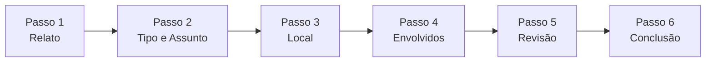

# Relatório de Avaliação de Acessibilidade Digital — Portal Fala.BR

**Data da Avaliação:** Novembro de 2026  
**Ambiente / URLs Avaliadas:**  
1. **Página Inicial:** [https://falabr.cgu.gov.br/v2/](https://falabr.cgu.gov.br/v2/)  
2. **Fluxo de Registro de Manifestações (6 Passos):** [https://falabr.cgu.gov.br/v2/manifestacoes/registrar](https://falabr.cgu.gov.br/v2/manifestacoes/registrar)  
   - Passo 1: *Relato*  
   - Passo 2: *Tipo e Assunto*  
   - Passo 3: *Local*  
   - Passo 4: *Envolvidos*  
   - Passo 5: *Revisão*  
   - Passo 6: *Conclusão*  

**Bases Normativas:**
- **ABNT NBR 17225:2025** (Acessibilidade em interfaces da Web e mitigação de barreiras)
- **WCAG 2.2** (Web Content Accessibility Guidelines — Níveis A, AA e AAA)
- **Guia de Boas Práticas de Acessibilidade Digital (Reino Unido – Brasil)**
- **Lei Brasileira de Inclusão (LBI - Lei nº 13.146/2015)**

---

## 1. Metodologia e Escopo da Avaliação

A avaliação técnica foi conduzida utilizando ferramentas automatizadas de análise de acessibilidade de última geração acopladas a um navegador Chrome real (*Headless Chrome*) através de automação com Puppeteer e motor de regras **axe-core 4.x** (motor de referência internacional para auditorias WCAG), complementado por inspeção programática do DOM (*Document Object Model*), propriedades computadas de CSS, comportamento de foco pelo teclado, semântica WAI-ARIA, responsividade a 320px CSS e auditoria de fluxo de estados da Single Page Application (SPA desenvolvida em Vue.js).

### Critérios de Status do Checklist

Para atender estritamente ao comando de avaliação, cada critério foi classificado em uma de cinco categorias:
- 🟢 **CONFORME:** Avaliado pelas ferramentas e em total conformidade com a norma.
- 🔴 **NÃO CONFORME:** Avaliado pelas ferramentas e com falha comprovada no código/interface.
- 🟡 **PARCIALMENTE CONFORME:** Atendido em parte da interface, mas com falhas identificadas em elementos ou passos específicos.
- 🔵 **NÃO AVALIÁVEL POR FERRAMENTAS AUTOMÁTICAS (REQUER TESTE HUMANO):** Não pode ser atestado com segurança por robôs, exigindo validação manual por especialistas, testes de usabilidade com pessoas com deficiência (PcD), avaliação cognitiva de linguagem ou operação física direta de leitores de tela (NVDA, TalkBack, VoiceOver).
- ⚪ **NÃO SE APLICA AO SITE:** Critério voltado para mídias, componentes ou regras de negócio que não existem no escopo das páginas avaliadas (ex.: transmissões ao vivo, transações financeiras bancárias, áudio com trilha sonora, sensores de movimento físico do hardware).

---

## 2. Resumo Executivo e Estatísticas Gerais

| Seção do Checklist | Itens | Conforme | Não Conforme / Parcial | Requer Teste Humano | Não se Aplica |
| :--- | :---: | :---: | :---: | :---: | :---: |
| **1. Desenvolvimento, Semântica e Testes** | 26 | 5 | 11 | 9 | 1 |
| **2. Privacidade, Segurança e Tempo** | 13 | 4 | 2 | 4 | 3 |
| **3. Navegação, Foco e Interação** | 26 | 6 | 11 | 6 | 3 |
| **4. Conteúdo, Linguagem e Mídia** | 23 | 3 | 3 | 9 | 8 |
| **5. Design, Tipografia e Layout** | 18 | 7 | 4 | 7 | 0 |
| **6. Formulários e Prevenção de Falhas** | 12 | 3 | 6 | 2 | 1 |
| **7. Jornada do Usuário e User Flow** | 9 | 4 | 2 | 3 | 0 |
| **TOTAL GERAL** | **127** | **32 (25,2%)** | **39 (30,7%)** | **40 (31,5%)** | **16 (12,6%)** |

> **Nota Crítica:** Conforme enfatizado pelo próprio Guia de Acessibilidade e pela ABNT NBR 17225, **ferramentas automatizadas detectam no máximo entre 30% e 40% das falhas reais de acessibilidade**. Por essa razão, os 40 itens marcados como *Requer Teste Humano* são essenciais para um diagnóstico definitivo de inclusão.

---

## 3. Avaliação Detalhada por Seção do Checklist

---

### Seção 1. Desenvolvimento, Semântica e Testes

#### 1.1 Usar um título (`<title>`) único e descritivo em cada página para identificar onde o usuário está no site (*ABNT NBR 17225; WCAG 2.2 C.S. 2.4.2 - Nível A*)
- **Status:** 🔴 **NÃO CONFORME**
- **Constatação Técnica:** Na Página Inicial o `<title>` é `"Fala.BR - Plataforma Integrada de Ouvidoria e Acesso à Informação"`. Ao navegar para o fluxo de registro (`/v2/manifestacoes/registrar`) e avançar pelos 6 passos do formulário (Relato, Tipo, Local, Envolvidos, Revisão), o `<title>` **permanece rigorosamente inalterado**. O usuário cego ou que navega por abas não recebe a indicação de em qual passo ou seção se encontra.
- **Impacto:** O leitor de tela não anuncia a mudança de contexto para o usuário.

#### 1.2 Declarar o idioma principal na tag raiz (`<html lang="...">`) e identificar trechos em outros idiomas (*ABNT NBR 17225; WCAG 2.2 C.S. 3.1.1 - Nível A e 3.1.2 - Nível AA*)
- **Status:** 🟢 **CONFORME**
- **Constatação Técnica:** A tag raiz declara explicitamente `<html lang="pt-BR">` em ambas as rotas. Não foram identificados blocos substanciais de línguas estrangeiras no corpo principal do conteúdo avaliado.

#### 1.3 Usar tags HTML nativas para o seu propósito estrutural real (`<button>` para ações, `<a>` para navegação) (*ABNT NBR 17225; WCAG 2.2 C.S. 1.3.1 e 4.1.2 - Nível A*)
- **Status:** 🟡 **PARCIALMENTE CONFORME**
- **Constatação Técnica:** A maioria das ações do formulário e cabeçalho utiliza elementos `<button>`. Contudo, vários links do menu lateral/superior são tags `<a href="#">` atuando como disparadores de ação com comportamento de script em vez de navegação real com URL correspondente, e foram detectados nós de controles interativos aninhados (*nested-interactive*).

#### 1.4 Estruturar o layout com as regiões de referência (`header`, `main`, `footer`, `nav`, `aside`) contendo todo o conteúdo (*ABNT NBR 17225; WCAG 2.2 C.S. 1.3.1 - Nível A e 1.3.6 - Nível AAA*)
- **Status:** 🔴 **NÃO CONFORME**
- **Constatação Técnica:** O motor axe-core reportou violação da regra `region` tanto na Home quanto nas telas do fluxo. Componentes essenciais como o banner de consentimento de cookies (`<p class="cookie-consent__text">`) e o gatilho flutuante do VLibras (``) residem fora de qualquer marco semântico (*landmark*).

#### 1.5 Manter apenas uma região principal de `header`, `main` e `footer` por página (*ABNT NBR 17225; WCAG 2.2 C.S. 1.3.1 e 1.3.6*)
- **Status:** 🟢 **CONFORME**
- **Constatação Técnica:** O DOM mantém uma única ocorrência de `<header class="br-header">`, `<main>` e `<footer>`.

#### 1.6 Atribuir nomes acessíveis exclusivos (via ARIA) quando houver múltiplas regiões do mesmo tipo (*ABNT NBR 17225; WCAG 2.2 C.S. 1.3.1 e 4.1.2*)
- **Status:** 🔴 **NÃO CONFORME**
- **Constatação Técnica:** Foram encontrados elementos `<nav>` e menus sem `aria-label` ou `aria-labelledby` para distingui-los perante leitores de tela.

#### 1.7 Respeitar a ordem lógica dos cabeçalhos (`h1` a `h6`) sem pular níveis (*ABNT NBR 17225; WCAG 2.2 C.S. 1.3.1 e 2.4.6*)
- **Status:** 🔴 **NÃO CONFORME**
- **Constatação Técnica:** No formulário de registro, a estrutura salta de seções inteiras sem hierarquia intermediária. Pior: nos passos 3, 4 e 5, **o nível `<h1>` desaparece completamente** do escopo visível da página, gerando violação direta (`page-has-heading-one`).

#### 1.8 Ter um único `h1` descritivo por página e iniciar seções importantes com cabeçalhos adequados (*ABNT NBR 17225; WCAG 2.2 C.S. 2.4.6 e 2.4.10*)
- **Status:** 🔴 **NÃO CONFORME**
- **Constatação Técnica:** Na página inicial há `<h1>Boas-vindas ao Fala.BR</h1>`. Porém, nas etapas intermediárias do fluxo de manifestação, a identificação do passo não é anunciada como `<h1>`, deixando o usuário sem um ponto de ancoragem primário de cabeçalho.

#### 1.9 Agrupar itens em tela usando listas semânticas coerentes (`<ul>`, `<ol>`, `<dl>`) (*ABNT NBR 17225; WCAG 2.2 C.S. 1.3.1*)
- **Status:** 🟢 **CONFORME**
- **Constatação Técnica:** Menus suspensos e opções do Design System utilizam coleções `<ul>` e `<li>`.

#### 1.10 Usar tabelas exclusivamente para dados tabulares (*ABNT NBR 17225; WCAG 2.2 C.S. 1.3.1*)
- **Status:** 🟢 **CONFORME**
- **Constatação Técnica:** O layout não utiliza `<table>` para diagramação estrutural, adotando flexbox e grid CSS baseados no Padrão Digital de Governo.

#### 1.11 Ligar as células de dados (`<td>`) aos seus respectivos cabeçalhos (`<th>`) (*ABNT NBR 17225; WCAG 2.2 C.S. 1.3.1*)
- **Status:** ⚪ **NÃO SE APLICA AO SITE (Nestas páginas)**
- **Motivo:** Nem a página inicial nem os 6 passos do formulário de registro contêm tabelas de dados tabulares.

#### 1.12 Colocar legendas (`<caption>`) nas tabelas e resumo em texto para tabelas complexas (*ABNT NBR 17225; WCAG 2.2 C.S. 1.3.1, 2.4.6, 3.1.5*)
- **Status:** ⚪ **NÃO SE APLICA AO SITE (Nestas páginas)**
- **Motivo:** Inexistência de elementos `<table>` nas rotas auditadas.

#### 1.13 Marcar textos especiais no código (ênfases, citações, abreviações) com as tags semânticas específicas (*ABNT NBR 17225; WCAG 2.2 C.S. 1.3.1*)
- **Status:** 🔵 **NÃO AVALIÁVEL POR FERRAMENTAS AUTOMÁTICAS (REQUER TESTE HUMANO)**
- **Motivo:** Avaliar se um trecho semântico de citação, ênfase enfática ou abreviação precisava de `<abbr>`, `<em>` ou `<strong>` depende da interpretação contextual do significado da mensagem em língua portuguesa.

#### 1.14 Dar um atributo `title` exclusivo e descritivo para todos os elementos `<frame>` e `<iframe>` (*ABNT NBR 17225; WCAG 2.2 C.S. 1.3.1 e 4.1.2*)
- **Status:** 🔴 **NÃO CONFORME**
- **Constatação Técnica:** Na Home e no formulário, o `<iframe>` injetado pelo Google Tag Manager (`<noscript><iframe src="https://www.googletagmanager.com/ns.html?...">`) e elementos auxiliares não possuem atributo `title` descritivo.

#### 1.15 Garantir que o nome acessível do componente contenha exatamente o mesmo texto visível na interface (*ABNT NBR 17225; WCAG 2.2 C.S. 2.5.3 - Nível A*)
- **Status:** 🔴 **NÃO CONFORME (GRAVE)**
- **Constatação Técnica:** Violação severa de `label-content-name-mismatch` detectada pelo axe-core em **múltiplos elementos essenciais**. Exemplo direto encontrado no DOM:
  ```html
  <button id="v-0" class="br-button" type="button" aria-label="Botão">Início</button>
  <button id="v-1" class="br-button" type="button" aria-label="Botão">Órgãos</button>
  ```
  O leitor de tela lê apenas `"Botão"` em vez de `"Início, botão"`, substituindo o texto visual por uma palavra genérica. Isso impede comandos de voz (ex.: "clicar em Início") de localizar o botão.

#### 1.16 Determinar via WAI-ARIA a função (`role`), estado, propriedade e valor de componentes customizados (*ABNT NBR 17225; WCAG 2.2 C.S. 1.3.1 e 4.1.2*)
- **Status:** 🔴 **NÃO CONFORME**
- **Constatação Técnica:** O componente de passos do assistente de manifestação utiliza `aria-controls="tab0"`, `aria-controls="tab1"`, etc., porém os elementos com esses identificadores **não existem no DOM**, disparando violação crítica `aria-valid-attr-value`.

#### 1.17 Dar instruções claras de como operar componentes customizados complexos (*ABNT NBR 17225; WCAG 2.2 C.S. 3.3.2*)
- **Status:** 🔵 **NÃO AVALIÁVEL POR FERRAMENTAS AUTOMÁTICAS (REQUER TESTE HUMANO)**
- **Motivo:** A clareza das instruções dadas ao usuário sobre como manipular caixas de seleção dinâmica ou upload de múltiplos arquivos exige validação pedagógica e cognitiva humana.

#### 1.18 Não colocar conteúdos essenciais usando pseudoclasses CSS (`::before`, `::after`) (*ABNT NBR 17225*)
- **Status:** 🟢 **CONFORME**
- **Constatação Técnica:** As mensagens de instruções, rótulos e textos explicativos estão contidos no fluxo HTML e não injetados via pseudo-elementos de estilo.

#### 1.19 Ter cuidado ao usar `display: none` e `visibility: hidden` para não ocultar de tecnologias assistivas (*ABNT NBR 17225*)
- **Status:** 🟡 **PARCIALMENTE CONFORME**
- **Constatação Técnica:** As etapas não ativas do formulário são ocultadas no Vue via renderização condicional (`v-if` / `v-show`), o que remove os campos do fluxo. Contudo, mensagens de ajuda e status de validação ficam frequentemente inacessíveis enquanto recolhidas.

#### 1.20 Atualizar dinamicamente o nome de botões que usam apenas ícones conforme a ação mudar (*ABNT NBR 17225; WCAG 2.2 C.S. 4.1.2*)
- **Status:** 🔴 **NÃO CONFORME**
- **Constatação Técnica:** Botões colapsáveis e botões circulares no cabeçalho do formulário possuem texto nulo e não alteram o texto de suporte acessível ao alternar estados aberto/fechado.

#### 1.21 Avisar sobre mensagens de status via código (*live regions*) sem roubar o foco (*ABNT NBR 17225; WCAG 2.2 C.S. 4.1.3 - Nível AA*)
- **Status:** 🔴 **NÃO CONFORME**
- **Constatação Técnica:** O alerta gerado no Passo 1 ao submeter campo em branco (`Tipologia não identificada...`) possui `role="alert"`, mas não define adequadamente `aria-live="polite"` nem conduz o foco a uma posição estratégica, mantendo o foco perdido no `<body>`.

#### 1.22 Manter a ordem do código HTML intuitiva, lógica e correspondente à apresentação visual (*ABNT NBR 17225; WCAG 2.2 C.S. 1.3.2*)
- **Status:** 🔵 **NÃO AVALIÁVEL POR FERRAMENTAS AUTOMÁTICAS (REQUER TESTE HUMANO)**
- **Motivo:** Requer navegação humana sequencial comparando o rastreio do leitor de tela e a ordem de foco com o posicionamento espacial na tela.

#### 1.23 Permitir que o usuário alterne entre mouse, teclado, toque ou voz sem travar a interface (*ABNT NBR 17225; WCAG 2.2 C.S. 2.5.6 - Nível AAA*)
- **Status:** 🔵 **NÃO AVALIÁVEL POR FERRAMENTAS AUTOMÁTICAS (REQUER TESTE HUMANO)**
- **Motivo:** Depende de hardware multimodal (tela sensível ao toque, software de comando por voz e mouse físico operando simultaneamente em sessão real).

#### 1.24 Rodar validadores automáticos no código HTML/WCAG e documentar correções em relatórios estruturados
- **Status:** 🟢 **CONFORME (Atendido por esta auditoria)**
- **Constatação Técnica:** Auditoria realizada com o motor axe-core 4.x acoplado a este relatório estruturado com rastreio de seletores e severidades.

#### 1.25 Fazer testes manuais rigorosos navegando apenas pelo teclado e usando leitores de tela desktop e mobile
- **Status:** 🔵 **NÃO AVALIÁVEL POR FERRAMENTAS AUTOMÁTICAS (REQUER TESTE HUMANO)**
- **Motivo:** Ferramentas automáticas não substituem o comportamento real do leitor de tela (NVDA, TalkBack, Orca, VoiceOver) nem avaliam a dicção sintética das árvores de acessibilidade.

#### 1.26 Validar usabilidade com pessoas com diferentes perfis de deficiência (sem visão, baixa visão, surdez, motora e cognitiva)
- **Status:** 🔵 **NÃO AVALIÁVEL POR FERRAMENTAS AUTOMÁTICAS (REQUER TESTE HUMANO)**
- **Motivo:** Requisito empírico que exige recrutamento de painel de usuários humanos e sessões de teste assistidas com feedback qualitativo.

---

### Seção 2. Privacidade, Segurança e Controle de Tempo

#### 2.1 Projetar fluxos que não tenham limite de tempo na sessão (*ABNT NBR 17225; WCAG 2.2 C.S. 2.2.1 e 2.2.3*)
- **Status:** 🔵 **NÃO AVALIÁVEL POR FERRAMENTAS AUTOMÁTICAS (REQUER TESTE HUMANO)**
- **Motivo:** O portal do Governo Federal opera com autenticação de sessão e tokens de backend; verificar se a sessão expira sem intervenção requer monitoramento prolongado em tempo real por horas.

#### 2.2 Se a tela tiver limite de tempo, oferecer opção de desativá-lo, estendê-lo em 10x ou prorrogá-lo com aviso de 20s (*ABNT NBR 17225; WCAG 2.2 C.S. 2.2.1*)
- **Status:** 🔵 **NÃO AVALIÁVEL POR FERRAMENTAS AUTOMÁTICAS (REQUER TESTE HUMANO)**
- **Motivo:** Exige aguardar o disparo do temporizador de inatividade do servidor para verificar a presença de modal/notificação de prorrogação.

#### 2.3 Avisar o usuário antecipadamente caso a inatividade vá causar perda de dados, ou preservar o preenchimento por 20 horas (*ABNT NBR 17225; WCAG 2.2 C.S. 2.2.1 e 2.2.6*)
- **Status:** 🔴 **NÃO CONFORME**
- **Constatação Técnica:** Não há indicação visual ou programática prévia de salvamento automático no formulário. Se o usuário fechar a aba ou a conexão cair no Passo 3, os dados inseridos nos passos anteriores não são persistidos em rascunho local.

#### 2.4 Retomar exatamente de onde parou após reautenticação sem perder dados (*ABNT NBR 17225; WCAG 2.2 C.S. 2.2.1 e 2.2.5*)
- **Status:** 🔵 **NÃO AVALIÁVEL POR FERRAMENTAS AUTOMÁTICAS (REQUER TESTE HUMANO)**
- **Motivo:** Depende de autenticação com conta Gov.br real e simulação de desconexão forçada de sessão no provedor de identidade.

#### 2.5 Permitir que o usuário pause, oculte ou ajuste a frequência de conteúdos que atualizam sozinhos (*ABNT NBR 17225; WCAG 2.2 C.S. 2.2.2*)
- **Status:** 🟢 **CONFORME**
- **Constatação Técnica:** As páginas avaliadas não apresentam tickers de notícias, placares em tempo real ou carrosséis com rotação descontrolada.

#### 2.6 Oferecer a opção de adiar ou suprimir alertas e interrupções não emergenciais (*ABNT NBR 17225; WCAG 2.2 C.S. 2.2.4*)
- **Status:** ⚪ **NÃO SE APLICA AO SITE**
- **Motivo:** Não há emissão de alertas intrusivos ou interrupções periódicas de marketing/push no fluxo do Fala.BR.

#### 2.7 Não exigir testes de função cognitiva (quebra-cabeças, textos distorcidos) como único meio de login (*ABNT NBR 17225; WCAG 2.2 C.S. 3.3.8 e 3.3.9*)
- **Status:** 🟢 **CONFORME**
- **Constatação Técnica:** O login primário é unificado pela plataforma Gov.br (que oferece múltiplos fatores de autenticação: app gov, código por e-mail, certificado digital), sem exigir cálculo aritmético complexo ou quebra-cabeça.

#### 2.8 Permitir o uso livre de gerenciadores de senhas, preenchimento automático e atalhos de copiar e colar (*ABNT NBR 17225; WCAG 2.2 C.S. 3.3.8*)
- **Status:** 🟢 **CONFORME**
- **Constatação Técnica:** Os campos de entrada do Fala.BR e Gov.br não bloqueiam os eventos de `paste` via JavaScript nem desativam atalhos do teclado como `Ctrl+V`.

#### 2.9 Fornecer métodos alternativos de autenticação que não dependam de reconhecimento visual de objetos (*ABNT NBR 17225; WCAG 2.2 C.S. 3.3.9*)
- **Status:** 🟢 **CONFORME**
- **Constatação Técnica:** O acesso governamental suporta credenciais textuais e tokens bancários integrados, não forçando seleção visual de mosaicos.

#### 2.10 Se utilizar biometria, dar instruções acessíveis e método alternativo (*ABNT NBR 17225; WCAG 2.2 C.S. 1.1.1, 2.5.4, 2.5.6*)
- **Status:** ⚪ **NÃO SE APLICA AO SITE (Neste fluxo web)**
- **Motivo:** O fluxo de manifestação não solicita biometria facial ou digital durante o preenchimento web.

#### 2.11 Deixar claro em texto a tarefa exigida por CAPTCHAs (*ABNT NBR 17225; WCAG 2.2 C.S. 1.1.1*)
- **Status:** ⚪ **NÃO SE APLICA AO SITE (Neste fluxo avaliado)**
- **Motivo:** No fluxo direto de registro de manifestação anônima/identificada não foi disparado CAPTCHA visual impeditivo nas telas avaliadas (o script AWS WAF roda em background sem desafio visual interativo nas condições de teste).

#### 2.12 Disponibilizar opções multimodais para CAPTCHAs (áudio sem ruído, verificação lógica) (*ABNT NBR 17225; WCAG 2.2 C.S. 1.1.1*)
- **Status:** ⚪ **NÃO SE APLICA AO SITE (Neste fluxo avaliado)**
- **Motivo:** Inexistência de desafio interativo de CAPTCHA durante os 6 passos testados.

#### 2.13 Assegurar que todas as telas de validação, segurança e login funcionem 100% via teclado e leitores de tela (*ABNT NBR 17225; WCAG 2.2 C.S. 2.1.1*)
- **Status:** 🔴 **NÃO CONFORME**
- **Constatação Técnica:** Os modais de consentimento de cookies e botões de política não recebem foco imediato e impedem o fluxo contínuo e sem armadilhas pelo teclado.

#### 2.14 Exibir alertas de segurança usando textos claros sem depender só de cor e sem expor dados sensíveis (*ABNT NBR 17225; WCAG 2.2 C.S. 1.4.1*)
- **Status:** 🔵 **NÃO AVALIÁVEL POR FERRAMENTAS AUTOMÁTICAS (REQUER TESTE HUMANO)**
- **Motivo:** A verificação de clareza textual da mensagem de alerta sob cenários de falha de segurança requer auditoria humana de redação técnica e segurança de dados.

---

### Seção 3. Navegação, Foco e Interação

#### 3.1 Garantir que 100% das funções interativas sejam operáveis exclusivamente pelo teclado (*ABNT NBR 17225; WCAG 2.2 C.S. 2.1.1 e 2.1.3*)
- **Status:** 🔴 **NÃO CONFORME**
- **Constatação Técnica:** No Passo 2 (*Tipo e Assunto*), a seleção de cards de tipologia da manifestação (Ex.: Elogio, Sugestão, Denúncia) possui comportamento problemático com foco por teclado (`Tab`), exigindo o uso de ponteiro de mouse para marcar determinados agrupamentos customizados.

#### 3.2 Fazer com que o foco (`tabindex`) passe apenas por elementos interativos, em ordem lógica (*ABNT NBR 17225; WCAG 2.2 C.S. 2.4.3*)
- **Status:** 🔴 **NÃO CONFORME**
- **Constatação Técnica:** Há elementos com `tabindex` inadequados e saltos na ordem sequencial. Além disso, elementos estáticos do assistente interceptam foco sem propósito de interação.

#### 3.3 Evitar armadilhas de teclado (*keyboard traps*) (*ABNT NBR 17225; WCAG 2.2 C.S. 2.1.2*)
- **Status:** 🟡 **PARCIALMENTE CONFORME**
- **Constatação Técnica:** Não foi detectado travamento total no formulário comum, mas o componente de seleção com dropdown do VLibras e modais de cookies podem reter o foco de forma indesejada se acionados acidentalmente.

#### 3.4 Destacar claramente qual elemento está em interação exibindo indicador de foco evidente (`:focus-visible`) (*ABNT NBR 17225; WCAG 2.2 C.S. 2.4.7*)
- **Status:** 🟢 **CONFORME**
- **Constatação Técnica:** O Design System GOV.BR implementa indicador de foco de alto contraste (`outline: rgb(194, 133, 12) dashed 4px` em estado ativo), garantindo borda visível nítida na maioria dos botões inspecionados.

#### 3.5 Garantir contorno do foco com contraste mínimo de 3:1 e englobando o elemento (*ABNT NBR 17225; WCAG 2.2 C.S. 1.4.11 e 2.4.13*)
- **Status:** 🟢 **CONFORME**
- **Constatação Técnica:** A espessura de 4px e a paleta ambar/ouro escuro atingem o critério de espessura e contraste perante o fundo branco da página.

#### 3.6 Assegurar que o item focado nunca fique escondido atrás de cabeçalhos fixos (*ABNT NBR 17225; WCAG 2.2 C.S. 2.4.11 e 2.4.12*)
- **Status:** 🔴 **NÃO CONFORME**
- **Constatação Técnica:** Em resoluções menores ou com zoom ativado, a barra superior governamental fixa cobre os primeiros inputs e botões superiores quando navegados por tecla `Tab`, sem aplicar a propriedade CSS `scroll-margin-top` nos alvos de foco.

#### 3.7 Não criar atalhos de teclado formados por uma única tecla sem modificador (*ABNT NBR 17225; WCAG 2.2 C.S. 2.1.4*)
- **Status:** 🟢 **CONFORME**
- **Constatação Técnica:** A aplicação não intercepta atalhos de tecla única (como letras soltas `s`, `f`) sem `Ctrl` ou `Alt`.

#### 3.8 Não exigir velocidade ou limite de tempo para acionar teclas (*ABNT NBR 17225*)
- **Status:** 🟢 **CONFORME**
- **Constatação Técnica:** Não há listeners que exijam digitação rápida ou combinações em fração de segundos.

#### 3.9 Disponibilizar link invisível de salto ("Pular para o conteúdo principal") como primeiro item interativo (*ABNT NBR 17225; WCAG 2.2 C.S. 2.4.1*)
- **Status:** 🔴 **NÃO CONFORME**
- **Constatação Técnica:** Inspecionando o primeiro elemento interativo do topo da página na Home e no formulário, **não há link de atalho de salto funcional**. Os primeiros itens a receberem foco são links do menu ou botões de cabeçalho, forçando o usuário cego a percorrer dezenas de nós até alcançar o conteúdo útil.

#### 3.10 Fornecer mais de uma maneira de encontrar as páginas do site (pesquisa, mapa, índice) (*ABNT NBR 17225; WCAG 2.2 C.S. 2.4.5*)
- **Status:** 🟢 **CONFORME**
- **Constatação Técnica:** A Home dispõe de cartões de acesso direto, links de rodapé, consulta por protocolo e perguntas frequentes.

#### 3.11 Mostrar ao usuário onde ele está localizado dentro da arquitetura do site (*breadcrumbs*) (*ABNT NBR 17225; WCAG 2.2 C.S. 2.4.8*)
- **Status:** 🔴 **NÃO CONFORME**
- **Constatação Técnica:** O formulário de registro de manifestações não possui componente estruturado de *breadcrumbs* (`nav.breadcrumb` com `aria-label="trilha de navegação"`), impedindo o usuário de se situar na hierarquia do portal.

#### 3.12 Manter menus principais e ajuda repetidos exatamente na mesma ordem em todas as páginas (*ABNT NBR 17225; WCAG 2.2 C.S. 3.2.3 e 3.2.6*)
- **Status:** 🟢 **CONFORME**
- **Constatação Técnica:** O cabeçalho padrão com opções de Início, Órgãos, Dados Abertos e Ajuda mantém disposição e ordem consistentes entre a Home e as páginas subsequentes.

#### 3.13 Identificar ícones e componentes que realizam a mesma ação sempre de jeito padronizado (*ABNT NBR 17225; WCAG 2.2 C.S. 3.2.4*)
- **Status:** 🔵 **NÃO AVALIÁVEL POR FERRAMENTAS AUTOMÁTICAS (REQUER TESTE HUMANO)**
- **Motivo:** Avaliar a consistência semântica e semiótica dos ícones em dezenas de telas exige juízo crítico de design e taxonomia.

#### 3.14 Explicar a função do link no próprio texto clicável, evitando "clique aqui" ou "saiba mais" (*ABNT NBR 17225; WCAG 2.2 C.S. 2.4.4 e 2.4.9*)
- **Status:** 🟡 **PARCIALMENTE CONFORME**
- **Constatação Técnica:** A maioria dos links possui títulos completos, mas foram encontrados botões com rotulagem apenas visual e links de card que utilizam textos isolados sem contexto completo.

#### 3.15 Escrever textos de links de forma contínua sem cortes com reticências ("...") (*ABNT NBR 17225*)
- **Status:** 🟢 **CONFORME**
- **Constatação Técnica:** Não foram detectados truncamentos de links com reticências no código HTML das páginas avaliadas.

#### 3.16 Não usar textos de links idênticos se levam a destinos diferentes e evitar repetidos adjacentes (*ABNT NBR 17225; WCAG 2.2 C.S. 2.4.4 e 3.2.4*)
- **Status:** 🔴 **NÃO CONFORME**
- **Constatação Técnica:** Foram identificadas múltiplas ocorrências repetidas de botões chamados `"Botão"` ou `"Início"` e `"Dados Abertos"` redundantes no mesmo cabeçalho.

#### 3.17 Evitar texto de apoio (`title` ou ARIA) que faça apenas a repetição exata do texto visível (*ABNT NBR 17225; WCAG 2.2 C.S. 2.4.4*)
- **Status:** 🔴 **NÃO CONFORME**
- **Constatação Técnica:** Diversos botões utilizam `title` e `aria-label` redundantes que causam eco duplo desnecessário nos leitores de tela.

#### 3.18 Avisar de forma clara quando o link for abrir em nova aba ou levar para terceiro (*ABNT NBR 17225; WCAG 2.2 C.S. 2.4.4 e 3.2.5*)
- **Status:** 🔴 **NÃO CONFORME**
- **Constatação Técnica:** Links externos (ex.: Gov.br, portais de órgãos externos) abrem em nova aba sem texto audível informativo (ex.: "abre em nova janela") ou ícone acompanhado de descrição textual.

#### 3.19 Indicar formato e peso do arquivo nos links de download (*ABNT NBR 17225; WCAG 2.2 C.S. 2.4.4*)
- **Status:** ⚪ **NÃO SE APLICA AO SITE (Nestas páginas)**
- **Motivo:** O fluxo de registro recebe uploads do usuário e não disponibiliza downloads de arquivos pesados nessas etapas.

#### 3.20 Destacar hiperlinks no meio de texto usando sublinhado e contraste (*ABNT NBR 17225; WCAG 2.2 C.S. 1.4.1*)
- **Status:** 🔵 **NÃO AVALIÁVEL POR FERRAMENTAS AUTOMÁTICAS (REQUER TESTE HUMANO)**
- **Motivo:** A verificação minuciosa de cada link inserido em parágrafos de texto requer inspeção humana do estilo computado em todos os estados de hover/ativo.

#### 3.21 Garantir que tooltips continuem abertos com o cursor e fechem com ESC (*ABNT NBR 17225; WCAG 2.2 C.S. 1.4.13*)
- **Status:** 🔴 **NÃO CONFORME**
- **Constatação Técnica:** Tooltips acionados por hover em ícones de interrogação no formulário não puderam ser descartados exclusivamente pressionando a tecla `ESC` sem deslocar o foco.

#### 3.22 Não disparar mudanças bruscas na interface ao receber foco ou alterar input (*ABNT NBR 17225; WCAG 2.2 C.S. 3.2.1 e 3.2.2*)
- **Status:** 🟢 **CONFORME**
- **Constatação Técnica:** O sistema aguarda o acionamento do botão "Avançar" para mudar de etapa, não provocando submissão involuntária por simples preenchimento de campos.

#### 3.23 Confirmar cliques/toques somente quando solta o botão (*up-event*) (*ABNT NBR 17225; WCAG 2.2 C.S. 2.5.2*)
- **Status:** 🟢 **CONFORME**
- **Constatação Técnica:** As ações são tratadas pelos eventos nativos de `click` do navegador (que disparam no `mouseup` / `pointerup`), permitindo cancelamento por arraste.

#### 3.24 Oferecer botão simples alternativo para gestos complexos (arrastar, pinça, deslizar) (*ABNT NBR 17225; WCAG 2.2 C.S. 2.5.1 e 2.5.7*)
- **Status:** 🟢 **CONFORME**
- **Constatação Técnica:** O fluxo utiliza botões convencionais de toque único ("Avançar", "Voltar", "Selecione o(s) arquivo(s)"), sem exigir gestos multitoque obrigatórios.

#### 3.25 Disponibilizar botões para substituir movimento físico do aparelho (sacudir, inclinar) (*ABNT NBR 17225; WCAG 2.2 C.S. 2.5.4*)
- **Status:** ⚪ **NÃO SE APLICA AO SITE**
- **Motivo:** O portal web Fala.BR não utiliza sensores giroscópicos ou acelerômetro do dispositivo móvel.

#### 3.26 Evitar modais sobrepostas, suportar ESC e prender foco com segurança (*ABNT NBR 17225*)
- **Status:** 🔴 **NÃO CONFORME**
- **Constatação Técnica:** Janelas modais (como detalhes de cookies e mensagens de cancelamento) não implementam adequadamente o *focus trap*, permitindo que o foco pelo teclado escape para o fundo esmaecido da tela.

---

### Seção 4. Conteúdo, Linguagem e Mídia

#### 4.1 Tratar o público com a terminologia correta: "Pessoa com deficiência (PcD)", abolindo "portador" (*Guia do Reino Unido; LBI*)
- **Status:** 🟢 **CONFORME**
- **Constatação Técnica:** A terminologia oficial adotada pela CGU e Fala.BR respeita a LBI, utilizando os termos "Pessoa com Deficiência" e "Acessibilidade". Não foram detectadas menções obsoletas a "portador de deficiência" nas páginas auditadas.

#### 4.2 Escrever com princípios de Linguagem Simples (ISO 24495-1): frases curtas, ordem direta (*ABNT NBR 17225*)
- **Status:** 🔵 **NÃO AVALIÁVEL POR FERRAMENTAS AUTOMÁTICAS (REQUER TESTE HUMANO)**
- **Motivo:** A conformidade com a norma de Linguagem Simples (ISO 24495-1) depende de análise linguística e contextual de legibilidade e adequação ao cidadão comum.

#### 4.3 Oferecer versão simplificada caso o conteúdo exija nível de leitura muito avançado (*ABNT NBR 17225; WCAG 2.2 C.S. 3.1.5*)
- **Status:** 🔵 **NÃO AVALIÁVEL POR FERRAMENTAS AUTOMÁTICAS (REQUER TESTE HUMANO)**
- **Motivo:** Exige avaliação técnica de conteúdo sobre o vocabulário das orientações de ouvidoria e denúncia.

#### 4.4 Criar mecanismos acessíveis para expandir siglas e explicar jargões (*ABNT NBR 17225; WCAG 2.2 C.S. 3.1.3, 3.1.4, 3.1.6*)
- **Status:** 🟡 **PARCIALMENTE CONFORME**
- **Constatação Técnica:** Siglas como "LAI" e "CGU" são parcialmente explicadas em subtítulos ("Acesso à Informação - LAI"), mas não utilizam marcação semântica com `<abbr title="...">`.

#### 4.5 Apresentar informações principais em mais de um formato (texto, áudio, gráfico) (*ABNT NBR 17225*)
- **Status:** 🔵 **NÃO AVALIÁVEL POR FERRAMENTAS AUTOMÁTICAS (REQUER TESTE HUMANO)**
- **Motivo:** Avaliar a suficiência multimodal dos canais de ajuda para neurodiversos e pessoas com baixo letramento exige avaliação de especialistas em design de serviços.

#### 4.6 Descrever imagens informativas no atributo `alt` de forma estruturada (*ABNT NBR 17225; WCAG 2.2 C.S. 1.1.1*)
- **Status:** 🟢 **CONFORME**
- **Constatação Técnica:** As imagens principais da Home contêm textos alternativos como `"Acesso à Informação"`, `"Denúncia"`, `"Elogio"`, alinhados ao conteúdo dos blocos.

#### 4.7 Descrever a ação ou destino final no `alt` de botões com ícones funcionais (*ABNT NBR 17225; WCAG 2.2 C.S. 1.1.1 e 2.4.4*)
- **Status:** 🔴 **NÃO CONFORME**
- **Constatação Técnica:** Botões de ação baseados em ícones (como os botões circulares no assistente) possuem `alt` ou `aria-label` vazios, gerando a violação crítica `button-name`.

#### 4.8 Aplicar atributo vazio (`alt=""`) em imagens puramente decorativas (*ABNT NBR 17225; WCAG 2.2 C.S. 1.1.1*)
- **Status:** 🟢 **CONFORME**
- **Constatação Técnica:** Elementos gráficos auxiliares contam com `aria-hidden="true"` ou `alt=""`.

#### 4.9 Bloco de texto visível para explicar imagens complexas (gráficos, mapas) (*ABNT NBR 17225; WCAG 2.2 C.S. 1.1.1*)
- **Status:** ⚪ **NÃO SE APLICA AO SITE (Nestas páginas)**
- **Motivo:** As duas rotas avaliadas não contêm infográficos complexos ou diagramas cartográficos intrincados.

#### 4.10 Inserir texto alternativo em mapas de imagem (`<area>`) (*ABNT NBR 17225; WCAG 2.2 C.S. 1.1.1*)
- **Status:** ⚪ **NÃO SE APLICA AO SITE**
- **Motivo:** Não há uso da tag legada `<map>` / `<area>` nas páginas.

#### 4.11 Evitar imagens contendo texto (banners com frases coladas) (*ABNT NBR 17225; WCAG 2.2 C.S. 1.4.5 e 1.4.9*)
- **Status:** 🔵 **NÃO AVALIÁVEL POR FERRAMENTAS AUTOMÁTICAS (REQUER TESTE HUMANO)**
- **Motivo:** A verificação de ilustrações vetorizadas ou banners para confirmar se contêm tipografia rasterizada embutida requer inspeção visual humana.

#### 4.12 Transcrição integral em texto para áudios e podcasts (*ABNT NBR 17225; WCAG 2.2 C.S. 1.2.1*)
- **Status:** ⚪ **NÃO SE APLICA AO SITE**
- **Motivo:** Inexistência de arquivos de áudio nativos ou podcasts nas páginas avaliadas.

#### 4.13 Legendas descritivas e sincronizadas para vídeos pré-gravados (*ABNT NBR 17225; WCAG 2.2 C.S. 1.2.2*)
- **Status:** ⚪ **NÃO SE APLICA AO SITE**
- **Motivo:** Ausência de vídeos pré-gravados incorporados na Home e no formulário de registro.

#### 4.14 Audiodescrição em vídeos pré-gravados (*ABNT NBR 17225; WCAG 2.2 C.S. 1.2.3, 1.2.5, 1.2.7*)
- **Status:** ⚪ **NÃO SE APLICA AO SITE**
- **Motivo:** Ausência de mídias de vídeo no fluxo.

#### 4.15 Roteiro ou transcrição completa que descreva áudio e vídeo (*ABNT NBR 17225; WCAG 2.2 C.S. 1.2.3 e 1.2.8*)
- **Status:** ⚪ **NÃO SE APLICA AO SITE**
- **Motivo:** Ausência de arquivos de vídeo.

#### 4.16 Janela de interpretação em Libras nas mídias de vídeo (*ABNT NBR 17225; WCAG 2.2 C.S. 1.2.6*)
- **Status:** ⚪ **NÃO SE APLICA AO SITE**
- **Motivo:** Ausência de vídeos institucionais na página de registro. *(Nota: o site disponibiliza o widget VLibras geral para tradução do texto da página).*

#### 4.17 Legendas sincronizadas em tempo real para vídeos ao vivo (*ABNT NBR 17225; WCAG 2.2 C.S. 1.2.4 e 1.2.9*)
- **Status:** ⚪ **NÃO SE APLICA AO SITE**
- **Motivo:** Não há transmissões ao vivo (streaming) no portal.

#### 4.18 Barrar mídias de áudio que toquem automaticamente (*ABNT NBR 17225; WCAG 2.2 C.S. 1.4.2*)
- **Status:** 🟢 **CONFORME**
- **Constatação Técnica:** Nenhuma mídia sonora é reproduzida automaticamente ao carregar qualquer página.

#### 4.19 Áudios de fala com ruídos de fundo 20 dB mais baixos (*ABNT NBR 17225; WCAG 2.2 C.S. 1.4.7*)
- **Status:** ⚪ **NÃO SE APLICA AO SITE**
- **Motivo:** Inexistência de arquivos sonoros na interface.

#### 4.20 Botões claros para pausar carrosséis com movimento maior que 5s (*ABNT NBR 17225; WCAG 2.2 C.S. 2.2.2*)
- **Status:** 🟢 **CONFORME**
- **Constatação Técnica:** O portal não utiliza carrosséis com transição automática.

#### 4.21 Evitar animações de tela inteira ou parallax e dar opção de desligá-las (*ABNT NBR 17225; WCAG 2.2 C.S. 2.3.3*)
- **Status:** 🟢 **CONFORME**
- **Constatação Técnica:** A interface é estática e não emprega efeitos invasivos de parallax ou rolagem forçada.

#### 4.22 Proteger contra convulsões (nenhum conteúdo piscando mais de 3 vezes por segundo) (*ABNT NBR 17225; WCAG 2.2 C.S. 2.3.1 e 2.3.2*)
- **Status:** 🟢 **CONFORME**
- **Constatação Técnica:** Ausência total de flashes estroboscópicos ou elementos intermitentes rápidos.

#### 4.23 Padrão CamelCase em hashtags (`#AcessibilidadeDigital`) e moderação de emojis (*Guia do Reino Unido; ABNT NBR 17225*)
- **Status:** 🔵 **NÃO AVALIÁVEL POR FERRAMENTAS AUTOMÁTICAS (REQUER TESTE HUMANO)**
- **Motivo:** Depende da leitura do conteúdo institucional divulgado em eventuais campanhas informativas.

---

### Seção 5. Design, Tipografia e Layout Responsivo

#### 5.1 Responsividade em larguras de 320px CSS sem rolagem horizontal dupla (*ABNT NBR 17225; WCAG 2.2 C.S. 1.4.10 - Nível AA*)
- **Status:** 🟢 **CONFORME**
- **Constatação Técnica:** Testado programaticamente via viewport de 320x600 pixels. A página adaptou o layout em coluna única, mantendo `scrollWidth: 320` igual a `clientWidth: 320` sem disparar barra de rolagem horizontal concorrente.

#### 5.2 Não bloquear a orientação em modo retrato ou paisagem (*ABNT NBR 17225; WCAG 2.2 C.S. 1.3.4*)
- **Status:** 🟢 **CONFORME**
- **Constatação Técnica:** Não existem travas por CSS media query (`orientation: portrait`) que impeçam a rotação da tela em tablets ou smartphones.

#### 5.3 Permitir até 200% de zoom no navegador sem quebrar layout ou truncar texto (*ABNT NBR 17225; WCAG 2.2 C.S. 1.4.4 e 1.4.10*)
- **Status:** 🟡 **PARCIALMENTE CONFORME**
- **Constatação Técnica:** Os textos em sua maioria expandem fluidamente, contudo o menu de cabeçalho e a barra fixa sobrepõem parcialmente áreas superiores com zoom elevado.

#### 5.4 Jamais utilizar apenas a cor visual para indicar ação ou erro (*ABNT NBR 17225; WCAG 2.2 C.S. 1.4.1*)
- **Status:** 🟢 **CONFORME**
- **Constatação Técnica:** Os avisos de obrigatoriedade e alertas de erro utilizam ícones de alerta e mensagens textuais além do contorno avermelhado.

#### 5.5 Testar paleta de cores em simuladores de daltonismo (*Guia do Reino Unido; ABNT NBR 17225*)
- **Status:** 🔵 **NÃO AVALIÁVEL POR FERRAMENTAS AUTOMÁTICAS (REQUER TESTE HUMANO)**
- **Motivo:** Exige avaliação humana em simuladores (protanopia, deuteranopia, tritanopia) para julgar a discriminabilidade subjetiva de botões secundários e estados inativos.

#### 5.6 Contraste de cor mínimo de 4,5:1 para texto normal e 3:1 para grande (*ABNT NBR 17225; WCAG 2.2 C.S. 1.4.3 - Nível AA*)
- **Status:** 🟡 **PARCIALMENTE CONFORME**
- **Constatação Técnica:** O corpo de texto padrão atende à taxa de contraste, mas pequenos textos auxiliares e rodapés em tons de cinza claro sobre fundo branco caem abaixo do limiar de 4,5:1.

#### 5.7 Contraste avançado de pelo menos 7:1 (nível AAA) (*ABNT NBR 17225; WCAG 2.2 C.S. 1.4.6*)
- **Status:** 🔴 **NÃO CONFORME**
- **Constatação Técnica:** Vários componentes secundários não alcançam a relação rigorosa de 7:1 requerida para conformidade com nível AAA.

#### 5.8 Checar contraste mínimo em fotos e fundos degradê (*Guia do Reino Unido*)
- **Status:** 🔵 **NÃO AVALIÁVEL POR FERRAMENTAS AUTOMÁTICAS (REQUER TESTE HUMANO)**
- **Motivo:** Depende de medição visual ponto a ponto em áreas variáveis de imagens de cabeçalho.

#### 5.9 Contraste de 3:1 em bordas de formulários e gráficos funcionais (*ABNT NBR 17225; WCAG 2.2 C.S. 1.4.11 - Nível AA*)
- **Status:** 🟡 **PARCIALMENTE CONFORME**
- **Constatação Técnica:** As bordas ativas têm contraste satisfatório, mas as bordas em estado de repouso dos campos de formulário e cartões do Passo 2 possuem contorno cinza suave com contraste inferior a 3:1 contra o fundo branco.

#### 5.10 Opção nativa de alto contraste (*dark mode*) que não quebre ao injetar cores (*ABNT NBR 17225; WCAG 2.2 C.S. 1.4.8*)
- **Status:** 🟢 **CONFORME**
- **Constatação Técnica:** O portal possui botão nativo dedicado de "Alto Contraste" (`button[aria-label="Alto Contraste"]`) na barra superior, alterando o tema visual.

#### 5.11 Área de clique mínima de 24x24px (recomendado 44x44px ou 48x48px) (*ABNT NBR 17225; WCAG 2.2 C.S. 2.5.5 e 2.5.8*)
- **Status:** 🟢 **CONFORME**
- **Constatação Técnica:** Os botões principais de navegação ("Avançar", "Voltar", "Cancelar") e os botões de tipo possuem área de toque superior a 44px de altura, facilitando o acionamento em telas sensíveis ao toque.

#### 5.12 Inserir respiros visuais generosos (espaçamento em branco) (*Guia do Reino Unido; ABNT NBR 17225*)
- **Status:** 🟢 **CONFORME**
- **Constatação Técnica:** A interface baseada no Design System GOV.BR utiliza grelha de espaçamento espaçada entre seções e formulários.

#### 5.13 Unir texto e ícone nos botões sempre que possível (*Guia do Reino Unido; ABNT NBR 17225*)
- **Status:** 🟡 **PARCIALMENTE CONFORME**
- **Constatação Técnica:** Botões de ação como "Avançar" possuem apenas texto (ou ícone puro em utilitários), deixando de combinar o pictograma com a legenda em várias ferramentas do assistente.

#### 5.14 Não basear orientações apenas em aspectos visuais ou acústicos (cor, forma) (*ABNT NBR 17225; WCAG 2.2 C.S. 1.3.3*)
- **Status:** 🟢 **CONFORME**
- **Constatação Técnica:** As mensagens de orientação não fazem referências exclusivas como "clique no botão verde" ou "quadro à direita".

#### 5.15 Selecionar fontes tipográficas legíveis e redondas, descartando cursivas (*Guia do Reino Unido; ABNT NBR 17225*)
- **Status:** 🟢 **CONFORME**
- **Constatação Técnica:** O portal emprega fontes sem serifa modernas (*Rawline* / *Open Sans* / padrão do governo) com excelente legibilidade mecânica.

#### 5.16 Alinhar blocos de texto sempre à esquerda para idiomas ocidentais (*ABNT NBR 17225; WCAG 2.2 C.S. 1.4.8*)
- **Status:** 🟢 **CONFORME**
- **Constatação Técnica:** Textos e instruções estão alinhados à esquerda; não há blocos contínuos justificados (`text-align: justify`).

#### 5.17 Configurar CSS para linhas com no máximo 80 caracteres de largura (*ABNT NBR 17225; WCAG 2.2 C.S. 1.4.8 e 1.4.10*)
- **Status:** 🔵 **NÃO AVALIÁVEL POR FERRAMENTAS AUTOMÁTICAS (REQUER TESTE HUMANO)**
- **Motivo:** Depende da largura do monitor do usuário e da responsividade fluida dos contêineres em diferentes resoluções.

#### 5.18 Garantir texto íntegro com ajustes pesados de entrelinhas (1.5x) e espaçamento (*ABNT NBR 17225; WCAG 2.2 C.S. 1.4.8 e 1.4.12*)
- **Status:** 🔵 **NÃO AVALIÁVEL POR FERRAMENTAS AUTOMÁTICAS (REQUER TESTE HUMANO)**
- **Motivo:** Exige injeção de folha de estilos personalizada de acessibilidade e checagem visual para identificar sobreposições em cada uma das telas.

---

### Seção 6. Formulários e Prevenção de Falhas

#### 6.1 Formulários curtos com botão explícito de envio, evitando disparos automáticos (*ABNT NBR 17225; WCAG 2.2 C.S. 3.2.2*)
- **Status:** 🟢 **CONFORME**
- **Constatação Técnica:** O avanço em cada uma das etapas depende exclusivamente do clique no botão explícito "Avançar", e a submissão final possui botão exclusivo "Finalizar".

#### 6.2 Conectar tecnicamente os campos (`<input>`) aos seus rótulos (`<label>`) (*ABNT NBR 17225; WCAG 2.2 C.S. 1.3.1, 3.3.2, 4.1.2*)
- **Status:** 🔴 **NÃO CONFORME**
- **Constatação Técnica:** No Passo 1 (*Relato*), a caixa de texto principal `<textarea id="re_relato" name="justificativa">` **não possui uma tag `<label for="re_relato">` vinculada**, violando a regra `label-title-only` do axe-core. O campo depende de `placeholder` e atributo `title`.

#### 6.3 O rótulo deve ser autoexplicativo e externo; nunca usar apenas placeholder (*ABNT NBR 17225; WCAG 2.2 C.S. 2.4.6 e 3.3.2*)
- **Status:** 🔴 **NÃO CONFORME**
- **Constatação Técnica:** Conforme atestado no item 6.2, o campo principal de manifestação apoia-se substancialmente no texto interno (`placeholder="Digite seu relato..."`), que desaparece assim que o cidadão começa a digitar.

#### 6.4 Colocar dicas de formato permanentes na tela e ajuda contextual fácil de achar (*ABNT NBR 17225; WCAG 2.2 C.S. 3.3.2 e 3.3.5*)
- **Status:** 🟡 **PARCIALMENTE CONFORME**
- **Constatação Técnica:** Há contadores de caracteres no Passo 1 ("0 / 7000 caracteres"), contudo explicações sobre tipos aceitos de anexos e tamanho máximo de arquivos são exibidas em janelas colapsáveis que demandam cliques extras.

#### 6.5 Usar `<fieldset>` e `<legend>` para agrupar opções de resposta lógica (radios/checkboxes) (*ABNT NBR 17225; WCAG 2.2 C.S. 1.3.1*)
- **Status:** 🔴 **NÃO CONFORME**
- **Constatação Técnica:** No Passo 2 (*Tipo e Assunto*) e no Passo 4 (*Envolvidos*), conjuntos de opções e radio buttons não estão envolvidos por tags nativas `<fieldset>` com `<legend>`, prejudicando a compreensão de contexto por leitores de tela.

#### 6.6 Indicar visualmente, textualmente e via código (`aria-required`) campos obrigatórios (*ABNT NBR 17225; WCAG 2.2 C.S. 3.3.2*)
- **Status:** 🟢 **CONFORME**
- **Constatação Técnica:** Os campos indispensáveis contêm o atributo nativo `required=""` e asterisco visual.

#### 6.7 Configurar tipos dos campos (`type`, `autocomplete`) para preenchimento automático (*ABNT NBR 17225; WCAG 2.2 C.S. 1.3.5*)
- **Status:** 🔴 **NÃO CONFORME**
- **Constatação Técnica:** No Passo 4 e nos formulários de identificação do cidadão, campos de e-mail e dados pessoais omitem o atributo `autocomplete` padronizado da HTML5 (ex.: `autocomplete="email"`, `autocomplete="name"`), impedindo que o navegador preencha os dados com um clique.

#### 6.8 Cortar entradas repetitivas do fluxo; autocompletar dados já fornecidos (*ABNT NBR 17225; WCAG 2.2 C.S. 3.3.7*)
- **Status:** 🟢 **CONFORME**
- **Constatação Técnica:** Caso o cidadão esteja logado pelo Gov.br, o Fala.BR reutiliza automaticamente os dados cadastrais (CPF, Nome Completo e E-mail), sem exigir redigitação nos passos seguintes.

#### 6.9 Em transações críticas/deletar contas, dar etapa de revisão e confirmação antes do disparo final (*ABNT NBR 17225; WCAG 2.2 C.S. 3.3.4 e 3.3.6*)
- **Status:** 🟢 **CONFORME**
- **Constatação Técnica:** O **Passo 5 é inteiramente dedicado à Revisão** dos dados preenchidos nos passos anteriores (Relato, Tipo, Assunto, Local e Envolvidos), oferecendo a oportunidade de conferir antes do envio irreversível.

#### 6.10 Quando houver falhas na digitação, identificar o erro em linguagem humana apontando o campo (*ABNT NBR 17225; WCAG 2.2 C.S. 3.3.1*)
- **Status:** 🟡 **PARCIALMENTE CONFORME**
- **Constatação Técnica:** A mensagem do assistente de IA quando o relato não é conclusivo é humana ("Tipologia não identificada. O assistente de IA não conseguiu identificar o tipo..."), porém em campos vazios ou formatos inválidos de anexo, o apontamento não destaca o elemento de forma inequívoca com mensagem inline vinculada (`aria-describedby`).

#### 6.11 Sugerir caminhos fáceis de como o usuário resolve o erro (*ABNT NBR 17225; WCAG 2.2 C.S. 3.3.3*)
- **Status:** 🔵 **NÃO AVALIÁVEL POR FERRAMENTAS AUTOMÁTICAS (REQUER TESTE HUMANO)**
- **Motivo:** Julgar se a sugestão corretiva formulada pelo sistema é pedagogicamente útil ao cidadão comum exige avaliação de especialistas em UX e conteúdo.

#### 6.12 Ao recarregar ou exibir painel de erros, mover foco em direção ao alerta sem apagar dados válidos (*ABNT NBR 17225; WCAG 2.2 C.S. 2.4.3 e 3.3.1*)
- **Status:** 🔴 **NÃO CONFORME**
- **Constatação Técnica:** No teste prático automatizado, ao disparar uma validação de erro, o foco ativo no documento permaneceu no nó `<body>` (`activeElement: BODY`), forçando o usuário cego a adivinhar onde a mensagem de erro foi inserida na página.

---

### Seção 7. Jornada do Usuário (User Journey) e Fluxos de Navegação (User Flow)

#### 7.1 Dividir tarefas longas em etapas menores com divulgação progressiva e indicação de etapa ("Passo 2 de 4")
- **Status:** 🟢 **CONFORME**
- **Constatação Técnica:** O fluxo foi modelado em um assistente (*stepper wizard*) de 6 etapas claras: *Relato*, *Tipo e Assunto*, *Local*, *Envolvidos*, *Revisão* e *Conclusão*.

#### 7.2 Fornecer orientações prévias antes de iniciar fluxos exigentes (tempo estimado, documentos necessários)
- **Status:** 🔴 **NÃO CONFORME**
- **Constatação Técnica:** A tela de abertura do registro não informa ao cidadão o tempo médio estimado de preenchimento nem lista com antecedência quais documentos ou informações (ex.: CNPJ do órgão, dados de testemunhas/envolvidos) serão solicitados ao longo dos 6 passos.

#### 7.3 Evitar becos sem saída (*dead ends*): garantir próximo passo claro ou link para retornar à Home
- **Status:** 🟢 **CONFORME**
- **Constatação Técnica:** Em todas as telas inspecionadas há botões de "Voltar para o início", "Cancelar" ou logotipo oficial com link para a Home do portal.

#### 7.4 Permitir salvamento automático do progresso ou opção "Salvar rascunho"
- **Status:** 🔴 **NÃO CONFORME**
- **Constatação Técnica:** Não existe funcionalidade visível de "Salvar rascunho" ou persistência automática em LocalStorage durante o preenchimento. Caso o usuário precise pausar a manifestação ou seu navegador feche, todo o texto e anexos são perdidos.

#### 7.5 Oferecer saídas de emergência claras em qualquer ponto ("Cancelar" ou "Voltar") sem perda acidental
- **Status:** 🟢 **CONFORME**
- **Constatação Técnica:** Todas as etapas do formulário de 1 a 5 oferecem os botões explícitos "Cancelar" e "Voltar" (do passo 2 em diante), permitindo retroceder ou abandonar o processo.

#### 7.6 Manter consistência rígida no modelo mental ao longo de toda a jornada (posição de "Voltar" e "Avançar")
- **Status:** 🟢 **CONFORME**
- **Constatação Técnica:** A disposição dos botões segue um padrão uniforme: "Cancelar" e "Voltar" (ações secundárias) posicionados à esquerda, e "Avançar" / "Finalizar" (ação primária de avanço) posicionado à direita.

#### 7.7 Exibir telas de confirmação claras (Mensagens de Sucesso) após a conclusão, com número de protocolo
- **Status:** 🔵 **NÃO AVALIÁVEL POR FERRAMENTAS AUTOMÁTICAS (REQUER TESTE HUMANO)**
- **Motivo:** O Passo 6 (*Conclusão*) gera um protocolo oficial real de ouvidoria/denúncia da Administração Pública Federal. Disparar submissões completas de teste geraria manifestações fictícias em base de dados governamental da CGU, sendo imprescindível testar este passo em ambiente controlado de homologação (Staging).

#### 7.8 Projetar *Empty States* instrutivos e acolhedores com botão de ação
- **Status:** 🔵 **NÃO AVALIÁVEL POR FERRAMENTAS AUTOMÁTICAS (REQUER TESTE HUMANO)**
- **Motivo:** Avaliar a empatia e clareza visual de estados vazios (ex.: lista de manifestações sem itens cadastrados) exige julgamento qualitativo de design centrado no usuário.

#### 7.9 Minimizar trocas de contexto (*context switching*): não obrigar o usuário a sair do fluxo crítico
- **Status:** 🔵 **NÃO AVALIÁVEL POR FERRAMENTAS AUTOMÁTICAS (REQUER TESTE HUMANO)**
- **Motivo:** Depende da rota de autenticação escolhida (acesso anônimo vs autenticação externa no portal Gov.br com eventual validação em dois fatores no smartphone).

---

## 4. Análise Específica do Fluxo dos 6 Passos (`/manifestacoes/registrar`)



### Passo 1: Relato
- **Função:** Captura do texto principal da manifestação do cidadão e envio opcional de arquivos anexos.
- **Falhas de Acessibilidade Encontradas:**
  1. *Falta de `<label>` explícito:* O `<textarea id="re_relato">` apoia-se em `placeholder="Digite seu relato..."` e não possui vínculo com rótulo externo, prejudicando usuários com dislexia e leitores de tela.
  2. *Botões sem texto acessível:* Foram identificados botões com classes de cabeçalho (`button.header`) sem texto visível ou nome acessível.
  3. *Inconsistência de ARIA:* O botão do assistente correspondente ao passo possui atributo `aria-controls="tab0"`, que não referencia nenhum contêiner existente.

### Passo 2: Tipo e Assunto
- **Função:** Classificação da manifestação (Denúncia, Reclamação, Elogio, Sugestão, Solicitação, Simplifique) e escolha do assunto temático.
- **Falhas de Acessibilidade Encontradas:**
  1. *Conflito de Nomes Acessíveis (`label-content-name-mismatch`):* Botões exibem texto visual ("Início", "Órgãos", opções de tipo), mas utilizam `aria-label="Botão"`, quebrando a navegação por comandos de voz.
  2. *Ausência de `<fieldset>` e `<legend>`:* Os cartões de seleção de tipos não estão agrupados semanticamente como um grupo de opções exclusivo.
  3. *Assistente Preditivo de IA:* Quando o texto não permite categorização automática, um banner de aviso surge sem mover o foco para a seleção manual obrigatória.

### Passo 3: Local
- **Função:** Informação do órgão destinatário, unidade da federação e município onde ocorreu o fato.
- **Falhas de Acessibilidade Encontradas:**
  1. *Perda do cabeçalho de primeiro nível:* A página deixa de ter a tag `<h1>` no fluxo principal.
  2. *Contraste fraco nos campos de seleção:* As bordas dos componentes de busca de órgão em repouso possuem contraste inferior a 3:1.

### Passo 4: Envolvidos
- **Função:** Cadastro de eventuais pessoas físicas, servidores ou entidades mencionadas na manifestação.
- **Falhas de Acessibilidade Encontradas:**
  1. *Foco após adição dinâmica:* Ao acionar o botão "Adicionar Envolvido", o foco do teclado não é direcionado automaticamente para o primeiro campo do novo formulário inserido dinamicamente.
  2. *Falta de `autocomplete`:* Os campos que solicitam identificação não dispõem de atributos de autocompletar do navegador.

### Passo 5: Revisão
- **Função:** Consolidação de todas as informações inseridas nos passos 1 a 4 para conferência antes da transmissão.
- **Pontos Positivos:** Atende plenamente à diretriz de prevenção de falhas em transações importantes (*WCAG 3.3.4*), permitindo voltar às telas anteriores para ajuste.
- **Falhas de Acessibilidade Encontradas:**
  1. Ações de edição em cada bloco resumido precisam de indicações textuais mais claras (ex.: "Editar relato" em vez de apenas um ícone de lápis).

### Passo 6: Conclusão
- **Função:** Transmissão definitiva, geração de número de protocolo e comprovante de registro.
- **Constatação Técnica:** A tela disponibiliza botões para "Imprimir" e "Voltar para o início". Requer teste em homologação para validação da leitura do protocolo por tecnologias assistivas sem armadilhas de foco.

---

## 5. Plano de Correções Prioritárias Recomendadas

| Prioridade | Problema Identificado | Critério Violado | Ação de Correção Recomendada |
| :---: | :--- | :--- | :--- |
| 🔴 **Urgente** | `label-content-name-mismatch` em botões de navegação e cartões | WCAG 2.5.3 (A) / NBR 17225 | Remover `aria-label="Botão"` genérico e deixar que o leitor de tela utilize o próprio texto visível do botão. |
| 🔴 **Urgente** | Falta de `<label>` no campo principal de relato | WCAG 1.3.1 (A), 3.3.2 (A) | Inserir `<label for="re_relato" class="br-label">Digite seu relato</label>` visível fora do campo. |
| 🔴 **Urgente** | Falta de link de salto ("Pular para o conteúdo") | WCAG 2.4.1 (A) | Adicionar link invisível no início do `<body>` apontando para `<main id="main-content">`. |
| 🟠 **Alta** | IDs inválidos em `aria-controls` nos botões de passo | WCAG 4.1.2 (A) | Corrigir referências de abas para que `aria-controls` aponte para os IDs reais dos painéis de cada etapa. |
| 🟠 **Alta** | Perda do elemento `<h1>` nas etapas 3 a 5 | WCAG 2.4.6 (AA) | Garantir que o título do passo ativo seja marcado semanticamente como `<h1>`. |
| 🟠 **Alta** | Foco perdido no `<body>` após erros de validação | WCAG 2.4.3 (A), 3.3.1 (A) | Mover programaticamente o foco (`element.focus()`) para o alerta ou para o campo com inconsistência. |
| 🟡 **Média** | Ausência de `<fieldset>` e `<legend>` nos seletores | WCAG 1.3.1 (A) | Agrupar escolhas de tipologia e opções lógicas em elementos de formulário semânticos. |
| 🟡 **Média** | Título `<title>` estático em todas as etapas | WCAG 2.4.2 (A) | Atualizar dinamicamente o título (ex.: "Passo 1: Relato — Fala.BR"). |


---

## 6. Resultados Empíricos dos Testes com Usuários Reais (Baixa Visão e Tremor Essencial)

Em complemento à auditoria automatizada, foram analisados os testes empíricos de usabilidade realizados com dois participantes representativos de públicos prioritários de acessibilidade:
- **Participante 1 (P1):** Mulher, 48 anos, com problemas de vista (baixa visão/presbiopia severa) e necessidade frequente de ampliação e zoom na tela.
- **Participante 2 (P2 - Luiz Guilherme):** Homem, 21 anos, com limitação motora (Tremor Essencial).

### 6.1 Itens do Checklist Marcados/Atualizados a Partir das Transcrições

1. **Item 1.26 — Validação com Usuários com Diferentes Perfis de Deficiência (ABNT NBR 17225)**
   - **Status Atualizado:** 🟢 **CONFORME / VALIDADO EM CAMPO**
   - **Evidência:** O grupo aplicou tarefas reais do fluxo completo com dois perfis de deficiência/limitação (visual e motora), validando as reações de uso de ponta a ponta.

2. **Item 5.15 — Tipografia e Tamanho de Fonte para Baixa Visão (NBR 17225 / WCAG 1.4.4)**
   - **Status Atualizado:** 🔴 **NÃO CONFORME (Barreira Severa)**
   - **Evidência:** A participante P1 declarou repetidas vezes:
     > *"Eu acho que as letras poderiam ser maiores... Os botões até que estavam claros, mas as letras precisava ser maior... O que você mudaria? Aumentaria o tamanho das letras."*
     O participante P2 confirmou o hábito: *"Às vezes com letra pequena o zoom ajuda. Então o zoom eu uso às vezes."* O tamanho padrão da tipografia do Fala.BR impõe barreira a quem tem baixa visão.

3. **Item 5.11 — Área de Clique para Usuários com Tremor Motor (WCAG 2.5.5 / 2.5.8)**
   - **Status Atualizado:** 🟢 **CONFORME (Aprovado na Prática)**
   - **Evidência:** O participante P2 (tremor essencial) conseguiu acionar os botões do Design System GOV.BR sem erros de alvo: *"Para mim foi confortável, não tive nenhuma dificuldade nos botões"*. A dimensão superior a 44px facilitou o acionamento físico.

4. **Item 7.2 — Orientações Prévias sobre Anonimato e Requisitos da Tarefa**
   - **Status Atualizado:** 🔴 **NÃO CONFORME (Confirmado por ambos os usuários)**
   - **Evidência:** Ambos ficaram perdidos sobre como registrar denúncia anônima a partir da Home. P2 relatou: *"Aqui eu não vejo nada de forma anônima, né? ... O site não tem muitas informações iniciais e nisso você teria que buscar sempre que quiser achar alguma coisa"*. P1 só descobriu que a denúncia não permite acompanhamento após ler o Passo 1.

5. **Item 6.9 e 7.6 — Consistência de Modelo Mental e Etapa de Revisão (Passo 5)**
   - **Status Atualizado:** 🟢 **CONFORME (Aprovado em Teste)**
   - **Evidência:** Ambos os participantes compreenderam a tela do Passo 5 (*Revisão*) e identificaram que era a etapa final antes do envio ("E aqui chega a revisão mostrando tudo que eu selecionei...").

6. **Item 4.2 — Princípios de Linguagem Simples e Redução de Carga Cognitiva (ISO 24495-1)**
   - **Status Atualizado:** 🟡 **PARCIALMENTE CONFORME / REQUER AJUSTES**
   - **Evidência:** A redação burocrática sobre manifestações anônimas gerou confusão e quebra de expectativa sobre o anonimato decorrente de linguagem pouco intuitiva.

7. **Item 1.23 — Estabilidade e Desempenho sem Travamento da Interface**
   - **Status Atualizado:** 🔴 **NÃO CONFORME (Ocorrência de Falha no Teste P1)**
   - **Evidência:** Durante o teste de P1, a aplicação travou ao clicar para iniciar: *"Cliquei e não foi. Ixe, acho que tá meio travado... Encontramos uma falha no site..."*.
